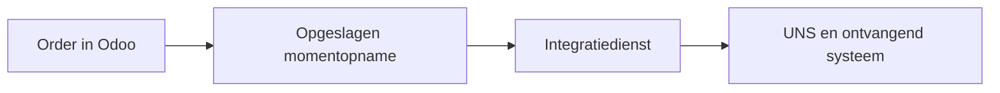
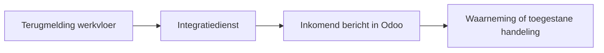

De Odoo UNS Connector geeft een productiesysteem een herkenbaar beeld van een Odoo-order en biedt Odoo een gecontroleerde route voor terugmeldingen. Hier lees je welke gegevensafspraken daarvoor nodig zijn en wat elke overdracht bewijst.

[English](/odoo-uns/architecture)

## Waarom zijn gegevensafspraken nodig?

Een order kan langs meerdere systemen gaan. Elk systeem gebruikt eigen namen en referenties. Zonder afspraak over de betekenis van de velden kan een aantal bij de verkeerde bewerking belanden of in een verkeerde eenheid worden gelezen. Een **datacontract** legt vast wat een bericht beschrijft, welke velden en referenties het gebruikt en hoe de deelnemers die interpreteren.

Een voorbeeld: Odoo maakt een productieorder voor zes panelen. Elk bericht beschrijft een herkenbare order of bewerking. Een ontvangend systeem kan daardoor naar dezelfde order of bewerking verwijzen zonder afhankelijk te zijn van de interne tabellen van Odoo.

| Afspraak | Voorbeeld en doel |
| --- | --- |
| Orderidentiteit en geplande hoeveelheid | De orderopname herkent de order en beschrijft zes panelen, het product, de eenheid en de status. |
| Bewerkingsidentiteit en orderreferentie | Een afzonderlijke opname herkent de bewerking en verwijst naar de order. |
| Uitvoeringssysteem | Eén ingesteld systeem mag over de bewerking terugmelden. Zo krijgen concurrerende systemen niet allebei die bevoegdheid voor dezelfde bewerking. |
| Teruggemeld aantal | Het aantal is een waarneming. De zender moet dezelfde eenheid gebruiken: de terugmelding heeft geen eenheidsveld en rekent niet om. |

De contractnamen voor productie in de connector zijn `_work_order` en `_operation`. Odoo beheert de identiteiten en de momentopnamen van orders en bewerkingen. De integratiedienst van de inrichting vertaalt die gegevens naar het afgesproken hubcontract en stuurt ze door. Een hub kan een eigen versie van een contract gebruiken; die vertaling moet expliciet zijn vastgelegd. De basisnamen van de momentopnamen bevatten geen versienummer. Een wijziging in de afspraak vraagt daarom afstemming tussen de deelnemers.

De Odoo-uitbreiding verzorgt de registraties en de interface. Een afzonderlijk ingerichte integratiedienst haalt berichten op en levert ze af. De UNS en de ontvangende toepassing hebben hun eigen taken; de uitbreiding voert die afleverdienst niet zelf uit.

## Waarom een outbox en niet alleen een webhook?

Een directe melding kan mislukken nadat een orderwijziging is opgeslagen. Wie de order later opnieuw ophaalt, kan een nieuwere stand krijgen dan de stand die de melding veroorzaakte. De transactionele outbox slaat de momentopname in dezelfde Odoo-transactie op als de gevolgde wijziging. Wordt die transactie teruggedraaid, dan verdwijnt ook de opname. Odoo kan de wijziging opslaan zonder op het ontvangende systeem te wachten. Na een onderbreking kan de afzonderlijk ingerichte dienst wachtende momentopnamen weer ophalen. Elke opname behoudt de inhoud die bij de wijziging is opgeslagen.

Een webhook kan nog steeds dienen als melding of om een dienst te activeren. Op zichzelf bewaart die niet duurzaam de exacte wijziging. De externe dienst heeft eigen duurzame opslag en een manier om opnieuw te proberen nodig. De outbox en herhaling garanderen geen eenmalige aflevering.

<Steps>
  <Step title="Odoo slaat de wijziging en opname op">
    Een nieuwe order of bewerking en een gevolgde wijziging leveren een momentopname op onder **Uitgaande berichten**. Ook een conceptorder kan een opname opleveren. Dit is informatie, geen opdracht om werk vrij te geven of een machine te starten.
  </Step>
  <Step title="De integratiedienst haalt de opname op">
    De dienst haalt wachtende berichten op en bevestigt dat hij het bericht duurzaam in beheer heeft genomen. **Ontvangst bevestigd door hub** legt die melding vast. Het bewijst niet dat een broker, hub of ontvangende toepassing de order heeft verwerkt.
  </Step>
  <Step title="Het ontvangende systeem gebruikt de gegevens">
    De integratie vertaalt en routeert de opname. De ontvangende toepassing gebruikt die volgens de ingerichte werkwijze. Aflevering en productie zijn verschillende resultaten.
  </Step>
  <Step title="Odoo controleert de terugmelding">
    De integratie biedt een terugmelding aan bij **Inkomende berichten**. Odoo controleert identiteit, order, bewerking, uitvoeringssysteem en gevraagde handeling. Een geldige waarneming kan de terugmeldingsvelden bij de werkorder wijzigen. Voor tijd, gereedmelding of voorraad gelden aanvullende voorwaarden en toestemmingen.
  </Step>
</Steps>

## Wat bewijst een status?

| Resultaat | Betekenis |
| --- | --- |
| **In afwachting** | Er is nog geen bevestiging van duurzaam beheer voor het uitgaande bericht. |
| **Ontvangst bevestigd door hub** | Een afnemer meldt dat hij het bericht duurzaam in beheer heeft genomen. Verdere verwerking is daarmee niet bewezen. |
| **Toegepast** | De verwerker heeft het ondersteunde resultaat vastgelegd. Dat kan alleen een waarneming zijn. |
| **Afgewezen** | Het verzoek is geweigerd; bekijk de reden. Sommige verkeerd gevormde verzoeken falen voordat een inkomend bericht kan worden vastgelegd. |
| Herhaald verzoek | Dezelfde terugmelding is eerder aangeboden. Het oorspronkelijke resultaat kan toegepast of afgewezen zijn. |

Dezelfde referentie van de terugmelding met andere inhoud wordt geweigerd. Een identieke herhaling geeft het oorspronkelijke resultaat terug zonder de handeling te herhalen. Zie [dagelijks gebruik](/nl/odoo-uns/workflow) voor de schermen en [instellingen](/nl/odoo-uns/settings) voor de afzonderlijke toestemmingen.
