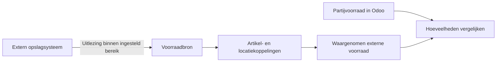
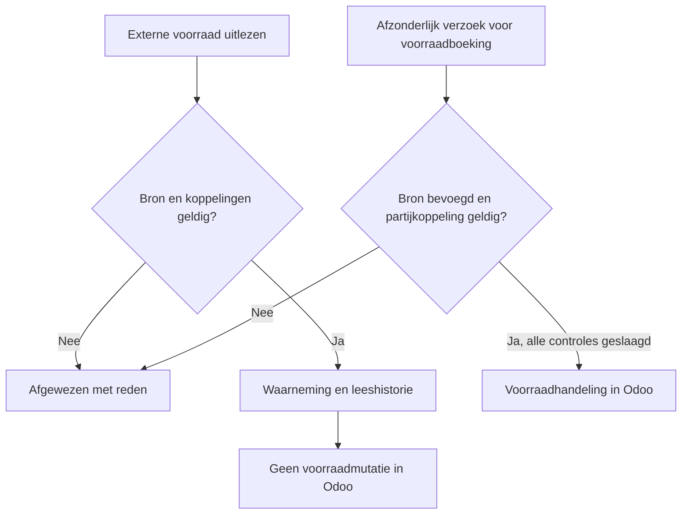

De optionele voorraaduitbreiding van de Odoo UNS Connector toont wat een extern systeem binnen een afgebakend bereik meldt. Daarmee kan een magazijnmedewerker de waarneming vergelijken met de voorraad in Odoo, zonder dat de uitlezing ongemerkt voorraad of waardering wijzigt.

[English](/odoo-uns/external-stock)

## Eén bereik, specifieke locaties

Een extern opslagsysteem meldt bijvoorbeeld plaatmateriaal op twee plekken: een rek en een snijzone. Een ingestelde bron en een bereik identificeren de externe uitlezing. Artikelkoppelingen verbinden elk extern artikel, elke locatie en eenheid met een bestaand Odoo-product, een bestaande **interne locatie** en de voorraadeenheid van dat product. De locatie in een koppeling is specifiek: daarmee wordt niet het hele magazijn of automatisch elke andere locatie geselecteerd.

Voor één product kunnen de koppelingen twee posities onderscheiden:

| Externe locatie | Interne locatie in Odoo |
| --- | --- |
| `RACK-A` | `WH/Stock/Rack A` |
| `CUTTING` | `WH/Stock/Cutting` |

De integratiedienst wordt ingericht om het bedoelde externe bereik uit te lezen en de bijbehorende locatiereferenties aan te leveren. Een UNS-beheerder maakt de bijbehorende koppelingen in Odoo. Het bereik benoemt de uitlezing; het is geen magazijnkiezer in Odoo. De [voorraaddocumentatie van Odoo](https://www.odoo.com/documentation/19.0/applications/inventory_and_mrp/inventory/warehouses_storage/inventory_management.html) legt het onderscheid tussen magazijnen en locaties uit.

## De externe voorraad bekijken

<Steps>
  <Step title="Open de bron">
    Open **UNS → Externe voorraad** en kies de bron. Het bedrijf en het bereik geven aan welke externe uitlezing bij deze pagina hoort.
  </Step>
  <Step title="Bekijk de waarneming">
    Controleer onder **Waargenomen externe voorraad** het gekoppelde product, de locatie en het waargenomen aantal. De **Leeshistorie** toont eerdere uitlezingen. Het tijdstip van de laatste geslaagde uitlezing laat zien wanneer de connector voor het laatst een succesvol resultaat kreeg; een tijdstip van de externe bron kan ontbreken.
  </Step>
  <Step title="Vergelijk met Odoo">
    Vergelijk de externe positie met **Partijvoorraad in Odoo** als partijkoppelingen zijn ingericht. Voorraad en reserveringen in Odoo zijn eigen registraties. Een verschil vraagt onderzoek volgens de afgesproken werkwijze; de waarneming boekt zelf geen correctie.
  </Step>
</Steps>

Een lege uitlezing betekent niet dat de voorraad nul is. Een geslaagde uitlezing van een deelbereik zegt niets over hoeveelheden buiten dat bereik. De instelling voor actualiteit bepaalt wanneer een uitlezing als verouderd wordt getoond. Dat zegt op zichzelf niet hoeveel materiaal er nu fysiek ligt.

<Tabs>
  <Tab title="Externe waarneming">
    De bron meldt wat binnen het ingestelde bereik is uitgelezen. De waarneming verandert de voorraad in Odoo niet.
  </Tab>
  <Tab title="Voorraad in Odoo">
    De partijvoorraad toont hoeveelheden en reserveringen in Odoo voor gekoppelde partijen. Een afzonderlijk toegestaan verzoek kan na de controles een voorraadmutatie boeken.
  </Tab>
</Tabs>

## De koppeling instellen

<Info>Een UNS-beheerder of administrator beheert bronnen en koppelingen. Een UNS-gebruiker kan de gegevens bekijken; de integratierol biedt de berichten aan.</Info>

<Steps>
  <Step title="Leg bron en bereik vast">
    Maak onder **UNS → Externe voorraad** een bron met het bedrijf, de bronreferentie en de bereiksreferentie. Samen identificeren zij het ingestelde uitleesbereik voor dat bedrijf. De integratiedienst moet dezelfde bron en hetzelfde bereik gebruiken.
  </Step>
  <Step title="Koppel elke externe positie">
    Koppel onder **Artikelkoppelingen** het externe artikel, de locatie en de eenheid aan een bestaand product, een interne Odoo-locatie en de voorraadeenheid van dat product. De connector rekent eenheden niet om. Een onbekend artikel, een onbekende locatie of een onbekende eenheid leidt tot afwijzing van de uitlezing; de koppeling wordt niet geraden.
  </Step>
  <Step title="Koppel partijen voor voorraadboekingen">
    **Native partijkoppelingen** verbinden een externe partij met een bestaande partij van het gekoppelde product. Het product moet partijvolging hebben. Native voorraad boeken vraagt afzonderlijke toestemming op de bron; waarnemen schakelt die niet in. Een artikelkoppeling kan niet worden gewijzigd naar een andere positie nadat er een voorraadwaarneming of partijkoppeling aan hangt. De koppellijsten bieden geen verwijderactie.
  </Step>
</Steps>

<Note>Met **Native voorraadboekingen toestaan** krijgt de bron toestemming voor de ondersteunde native voorraadcontracten samen. Het is geen schakelaar per locatie. De afzonderlijke koppelingen en bedrijfscontroles blijven gelden.</Note>

De [instellingen](/nl/odoo-uns/settings) beschrijven ook productieverbruik en publicatie van ontvangsten. Zie [problemen oplossen](/nl/odoo-uns/troubleshooting) als een uitlezing of boeking wordt afgewezen.
