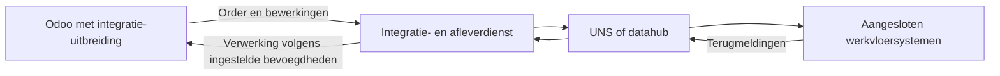

De Odoo UNS Connector verbindt Odoo Productie met aangesloten werkvloersystemen. Productieorders en bewerkingen gaan naar buiten. Voortgang en aantallen komen terug. Tijdregistratie, gereedmelding en voorraadboeking zijn afzonderlijk in te schakelen functies.

[English](/odoo-uns/overview)

## Wat lost de koppeling op?

Odoo legt vast wat er gemaakt moet worden. De uitvoering vindt plaats in machines, terminals en productiesystemen op de werkvloer.

De connector deelt ordergegevens via een **Unified Namespace (UNS)**. Dat is de gedeelde datalaag tussen de aangesloten systemen. Terugmeldingen kunnen vervolgens bij de juiste bewerking of order in Odoo worden verwerkt.

## Uit welke onderdelen bestaat de koppeling?

| Onderdeel | Functie |
| --- | --- |
| Integratie-uitbreiding in Odoo | Legt uitgaande ordergegevens vast en controleert welke terugmeldingen in Odoo mogen worden verwerkt. |
| Integratie- en afleverdienst | Verzorgt de overdracht tussen de Odoo-uitbreiding en de gedeelde datalaag. |
| UNS of datahub | Verdeelt de gegevens over de aangesloten systemen. |
| Aangesloten werkvloersystemen | Ontvangen ordergegevens en melden voortgang terug, volgens de afgesproken werkwijze. |
| Optionele voorraaduitbreidingen | Ondersteunen afzonderlijk toegestane voorraadboekingen en materiaalverbruik vanuit werkelijke partijen. |

## Hoe lopen de gegevens?

Odoo verstuurt een **momentopname**: de stand van de order op een bepaald moment. Ook een conceptorder kan zo'n momentopname opleveren.

<Note>
  Een momentopname versturen geeft geen werk vrij en start geen machine. De ontvangende toepassing volgt de afgesproken productieaansturing.
</Note>

## Wat verandert er zichtbaar in Odoo?

De productieorder krijgt het tabblad **UNS-integratie**, met de alleen-lezen **UNS-productieorderreferentie**.

Bij de werkorder toont hetzelfde tabblad de **Identiteit** en **Laatste terugkoppeling**. Daar zijn onder meer de externe status, het teruggekoppelde aantal en de terugkoppelingsnotitie te zien.

Onder het menu **UNS** staan de uitgaande en inkomende berichten. Het **Terugkoppelingslogboek** laat zien hoe een terugmelding is verwerkt.

<Frame caption="Illustratie van de extra UNS-informatie bij een werkorder. Voorbeeldgegevens; de indeling kan per inrichting verschillen.">
  
</Frame>

### Welke gegevens kunnen terugkomen?

| Terugmelding | Verwerking in Odoo |
| --- | --- |
| Voortgang en aantallen per bewerking | Vastleggen van de terugmelding van het ingestelde uitvoeringssysteem. |
| Gemeten tijd, indien ingeschakeld | Registreren van tijd bij de bewerking. |
| Gereedmelding, indien toegestaan | Afronden van de bewerking of productieorder. |
| Partijvoorraad, indien ingeschakeld | Vastleggen van waargenomen voorraad. Werkelijke voorraadboekingen vragen aparte toestemming. |

Per bewerking is één systeem ingesteld dat voortgang mag terugmelden. Een bericht ontvangen geeft niet automatisch toestemming om ook tijd, gereedmelding of voorraad te boeken.

## Wat blijft standaard Odoo?

De productieorder en de bijbehorende productie- en voorraadregistraties blijven in Odoo. De connector verwerkt alleen de handelingen die voor de betreffende werkwijze zijn ingeschakeld.

De connector ondersteunt **Odoo 19**. De zichtbare schermen en functies hangen af van de geïnstalleerde onderdelen en inrichting.

## Aan de slag

Volg [de productieorder en de terugmeldingen](/nl/odoo-uns/workflow). De [instellingen](/nl/odoo-uns/settings) beschrijven de afzonderlijke toestemmingen. Zie [problemen oplossen](/nl/odoo-uns/troubleshooting) als gegevens ontbreken.

De [productpagina](https://sheetmetalconnect.com/integratie-odoo-uns-connector) beschrijft de mogelijkheden en de inrichting.
