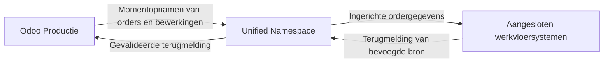

De Odoo UNS Connector verbindt Odoo Productie met de gedeelde productiedatalaag. De connector verstuurt ordergegevens en ontvangt terugmeldingen van bevoegde systemen. Zo kan uw team het werk volgen in Odoo en op de werkvloer.

[English](/odoo-uns/overview)

## Welke gegevens gaan heen en terug?

| Richting | Gegevens | Resultaat |
| --- | --- | --- |
| Odoo naar aangesloten systemen | Productieorders en bewerkingen | De orderstatus komt beschikbaar voor de ingerichte ontvangende systemen. |
| Aangesloten systemen naar Odoo | Voortgang en aantallen per bewerking | Terugmelding van het ingestelde uitvoeringssysteem wordt vastgelegd. |
| Aangesloten systemen naar Odoo, indien ingeschakeld | Gemeten tijd en gereedmelding | Kan tijd registreren of de bevoegde bewerking of productieorder in Odoo afronden. |
| Externe voorraad naar Odoo, indien ingeschakeld | Partijvoorraad en bevoegde boekingen | Houdt waargenomen voorraad apart van voorraad die werkelijk in Odoo is geboekt. |

Een **momentopname** legt de order op een bepaald moment vast. Ook een conceptorder kan een momentopname opleveren. Publicatie daarvan is geen opdracht om werk vrij te geven of een machine te starten.

## Beheerste terugmelding

Per bewerking is één systeem ingesteld dat de voortgang mag terugmelden. Tijdregistratie, gereedmelding van bewerkingen, gereedmelding van productieorders en voorraadboeking hebben eigen instellingen. Een bericht ontvangen schakelt die handelingen niet automatisch in.

De connector ondersteunt **Odoo 19**. Wat gebruikers zien hangt af van de geïnstalleerde onderdelen en afgesproken inrichting.

Lees de [werkwijze](/nl/odoo-uns/workflow), [instellingen](/nl/odoo-uns/settings) of [problemen oplossen](/nl/odoo-uns/troubleshooting). Voor commerciële informatie kunt u naar de [productpagina](https://sheetmetalconnect.com/integratie-odoo-uns-connector).
