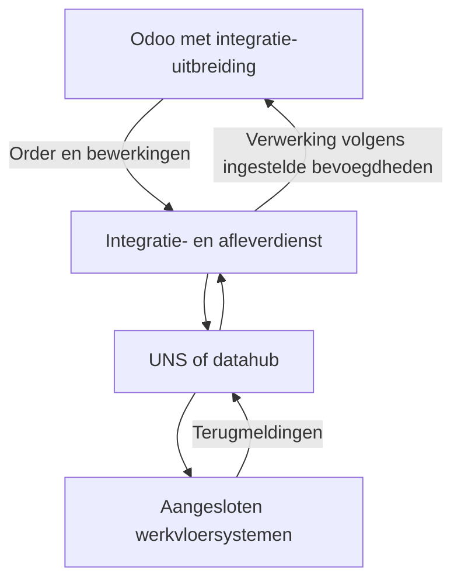
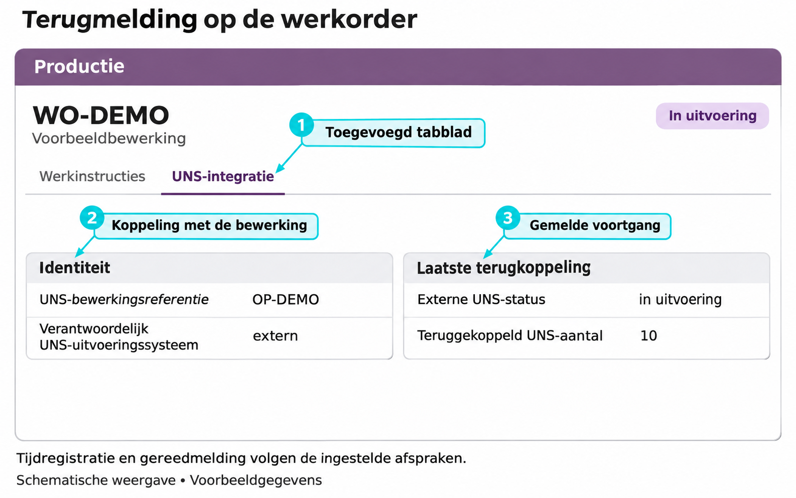

De Odoo UNS Connector verbindt Odoo Productie met aangesloten werkvloersystemen. Productieorders en bewerkingen gaan naar buiten. Voortgang en aantallen komen terug. Tijdregistratie, gereedmelding en voorraadboeking zijn afzonderlijk in te schakelen functies.

[English](/odoo-uns/overview)

## Wat lost de koppeling op?

Odoo legt vast wat er gemaakt moet worden. De uitvoering vindt plaats in machines, terminals en productiesystemen op de werkvloer.

De connector deelt ordergegevens via een **Unified Namespace (UNS)**. Dat is de gedeelde datalaag tussen de aangesloten systemen. Terugmeldingen kunnen vervolgens bij de juiste bewerking of order in Odoo worden verwerkt.

## Uit welke onderdelen bestaat de koppeling?

De connector scheidt berichtenverkeer, productie en voorraad. Zo gebruikt iedere inrichting de onderdelen die bij de werkwijze passen.

| Onderdeel | Functie |
| --- | --- |
| UNS-basis (`smc_uns`) | Beheert uitgaande en inkomende berichten, ontvangstbevestigingen en het terugkoppelingslogboek. Biedt de gedeelde UNS-schermen en toegangsrollen. |
| Productie-uitbreiding (`smc_mrp_uns`) | Voegt momentopnamen van orders en bewerkingen, terugmeldingsvelden en afzonderlijk toegestane productiehandelingen toe. Heeft de UNS-basis en Odoo Productie nodig. |
| Voorraaduitbreiding (`smc_stock_uns`) | Optioneel. Voegt externe voorraadbronnen, waarnemingen, koppelingen en afzonderlijk toegestane voorraadhandelingen in Odoo toe. |
| Uitbreiding productievoorraad (`smc_mrp_stock_uns`) | Optioneel. Verbindt toegestaan materiaalverbruik uit werkelijke partijen met de componentmutaties van een productieorder. |
| Integratiedienst en UNS | Een afzonderlijk ingerichte dienst haalt berichten op en levert die via de gedeelde datalaag af. De Odoo-uitbreidingen voeren die dienst niet zelf uit. |

## Hoe lopen de gegevens?

Bij een nieuwe productieorder of bijgehouden wijziging legt Odoo een **momentopname** vast: de stand van de order op dat moment. De opname wordt samen met de wijziging opgeslagen in een uitgaande berichtenlijst, de outbox. Ook een conceptorder kan zo'n opname opleveren. Valt de verbinding weg, dan kan de afleverdienst de vastgelegde wijzigingen opnieuw ophalen zodra de verbinding terug is.

**In afwachting** betekent dat er nog geen bevestiging van duurzaam beheer is; een dienst kan de opname al hebben opgehaald. **Ontvangst bevestigd door hub** betekent dat de integratiedienst meldt de opname duurzaam in beheer te hebben genomen. Het betekent niet dat alle ontvangers deze al hebben verwerkt. Een herhaalde terugmelding behoudt het oorspronkelijke resultaat: geaccepteerd of afgewezen.

<Note>
  Een momentopname versturen geeft geen werk vrij en start geen machine. De ontvangende toepassing volgt de afgesproken productieaansturing.
</Note>

## Wat verandert er zichtbaar in Odoo?

De productieorder krijgt het tabblad **UNS-integratie**, met de alleen-lezen **UNS-productieorderreferentie**.

Bij de werkorder toont hetzelfde tabblad de **Identiteit** en **Laatste terugkoppeling**. Daar zijn onder meer de externe status, het teruggekoppelde aantal en de terugkoppelingsnotitie te zien.

Onder het menu **UNS** staan de uitgaande en inkomende berichten. Het **Terugkoppelingslogboek** laat zien hoe een terugmelding is verwerkt.

<Frame caption="Illustratie van de extra UNS-informatie bij een werkorder. Voorbeeldgegevens; de indeling kan per inrichting verschillen.">
  
</Frame>

### Welke gegevens kunnen terugkomen?

| Terugmelding | Verwerking in Odoo |
| --- | --- |
| Voortgang en aantallen per bewerking | Vastleggen van de terugmelding van het ingestelde uitvoeringssysteem. |
| Gemeten tijd, indien ingeschakeld | Registreren van tijd bij de bewerking. |
| Gereedmelding, indien toegestaan | Afronden van de bewerking of productieorder. |
| Partijvoorraad, indien ingeschakeld | Vastleggen van waargenomen voorraad. Werkelijke voorraadboekingen vragen aparte toestemming. |

Odoo is standaard eigenaar van de uitvoering en wijst externe bewerkingsterugmeldingen af totdat een bron is toegestaan. Een bericht ontvangen geeft niet automatisch toestemming om ook tijd, gereedmelding of voorraad te boeken. Een productieorder kan via terugmelding alleen voor de volledige geplande hoeveelheid worden afgerond.

De optionele voorraaduitbreiding houdt waargenomen voorraad gescheiden van voorraadboekingen in Odoo. Aanvullende functies ondersteunen toegestane voorraadcorrecties, materiaalverbruik uit werkelijk gebruikte partijen en publicatie van ontvangen partijen voor artikelen waarvoor dat is ingeschakeld.

## Wat blijft standaard Odoo?

De productieorder en de bijbehorende productie- en voorraadregistraties blijven in Odoo. De connector verwerkt alleen de handelingen die voor de betreffende werkwijze zijn ingeschakeld.

De connector ondersteunt **Odoo 19**. De zichtbare schermen en functies hangen af van de geïnstalleerde onderdelen en inrichting.

## Aan de slag

Volg [de productieorder en de terugmeldingen](/nl/odoo-uns/workflow). De [instellingen](/nl/odoo-uns/settings) beschrijven de afzonderlijke toestemmingen. Zie [problemen oplossen](/nl/odoo-uns/troubleshooting) als gegevens ontbreken.

De [productpagina](https://sheetmetalconnect.com/integratie-odoo-uns-connector) beschrijft de mogelijkheden en de inrichting.

<Columns cols={2}>
  <Card title="Werking van de uitwisseling" href="/nl/odoo-uns/architecture">Lees waarom momentopnamen, beheer en terugmeldingen afzonderlijke resultaten hebben.</Card>
  <Card title="Externe voorraad" href="/nl/odoo-uns/external-stock">Vergelijk een externe uitlezing met Odoo-voorraad per locatie.</Card>
</Columns>
