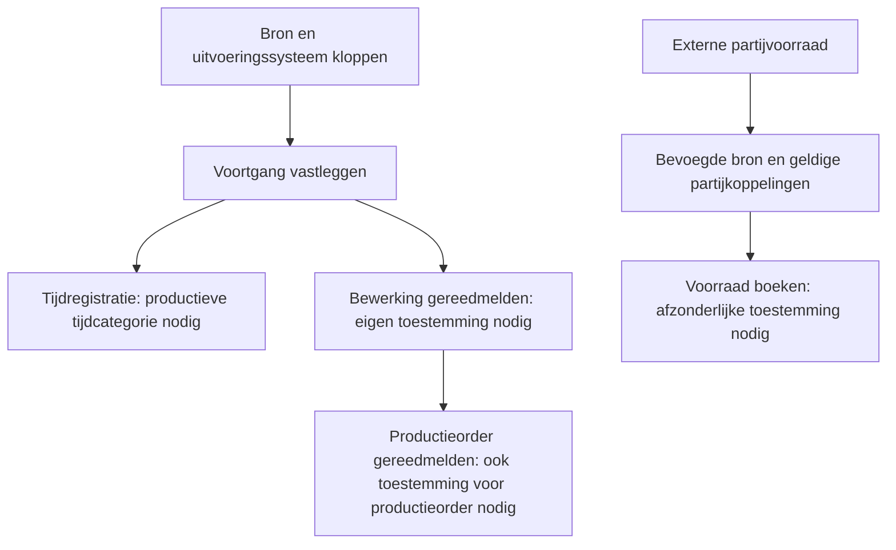

De Odoo UNS Connector kan voortgang vastleggen en, met de juiste instellingen, ook handelingen in Odoo uitvoeren. De beheerder stelt per werkwijze in welk systeem mag terugmelden en wat die terugmelding mag wijzigen.

[English](/odoo-uns/settings)

## Welk systeem meldt terug?

Het veld **Verantwoordelijk UNS-uitvoeringssysteem** bepaalt welk systeem de voortgang van een bewerking mag terugmelden.

Standaard is dat Odoo. Terugmeldingen van een extern systeem worden afgewezen totdat die bron is ingesteld.

## Tijd en gereedmelding

Elke handeling heeft eigen voorwaarden:

| Handeling | Benodigde instelling |
| --- | --- |
| Voortgang en aantallen bij een bewerking vastleggen | Het juiste uitvoeringssysteem voor de werkorder. |
| Tijd in Odoo registreren | Een productieve **Categorie voor native UNS-tijd**. |
| Een bewerking gereedmelden | **Native gereedmelding van bewerking toestaan**. |
| Een productieorder gereedmelden | Toestemming voor zowel bewerkings- als productieordergereedmelding. De laatste open bewerking wordt gevolgd door afronding van de productieorder. |

**Native** betekent in deze instellingen dat de handeling de eigen registratie van Odoo wijzigt. Alleen een externe waarneming opslaan is een andere handeling.

### Grenzen aan automatische gereedmelding

Automatische gereedmelding ondersteunt de **volledige geplande hoeveelheid**.

Gedeeltelijke gereedmelding en uitval worden via deze route niet ondersteund. Odoo-waarschuwingen, ontbrekende partijgegevens en backorders kunnen de afronding tegenhouden.

## Voorraad en materiaalverbruik

**Waargenomen externe voorraad** en **Partijvoorraad in Odoo** blijven apart. Een waarneming verandert de voorraad in Odoo niet vanzelf.

Voor externe voorraadboekingen zijn nodig:

- **Native voorraadboekingen toestaan**.
- Een bevoegde bron.
- Geldige partijkoppelingen.

### Materiaalverbruik vanuit een werkelijke partij

Voor productieverbruik vanuit een werkelijke materiaalpartij is een aanvullend onderdeel nodig. Ook moet het betreffende materiaal expliciet voor deze verwerking zijn toegestaan.

Alleen voorraadwaarneming inschakelen is daarvoor onvoldoende.

### Ontvangen partijen delen

Met **Ontvangen partijen naar UNS publiceren** wordt dit per product ingeschakeld. Er moet ook een bestemming voor ontvangstberichten zijn ingericht.

Deze uitwisseling betreft gevalideerde ontvangstregels van leveranciers.

<Note>
  Een gepubliceerde ontvangstregel kan via deze route niet worden gewijzigd, verwijderd of geretourneerd. Correcties en retouren volgen een afzonderlijk afgesproken werkwijze.
</Note>

Stem deze instellingen af op de werkwijze en de geïnstalleerde onderdelen. Zie [dagelijks gebruik](/nl/odoo-uns/workflow) voor de controle van resultaten en [problemen oplossen](/nl/odoo-uns/troubleshooting) bij afwijzingen.
