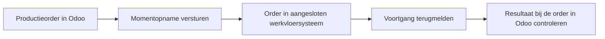

Met de Odoo UNS Connector werkt de werkvloer met ordergegevens uit Odoo. Het aangesloten systeem meldt de voortgang terug. Controleer bij de order welke gegevens zijn ontvangen en welke handelingen in Odoo zijn uitgevoerd.

[English](/odoo-uns/workflow)

## De dagelijkse werkwijze

<Steps>
  <Step title="Maak of wijzig de productieorder in Odoo">
    Nieuwe productieorders en gevolgde wijzigingen aan orders of bewerkingen leveren een uitgaande momentopname op.

    Het tabblad **UNS-integratie** toont de **UNS-productieorderreferentie**. Deze referentie is alleen-lezen.
  </Step>
  <Step title="Volg de order in het aangesloten systeem">
    Het werkvloersysteem ontvangt de ordergegevens via de ingerichte verbinding. De toepassing gebruikt die volgens de afgesproken werkwijze.

    Een verzonden momentopname is op zichzelf geen opdracht om productie te starten.
  </Step>
  <Step title="Controleer de terugmelding in Odoo">
    Open de werkorder bij de productieorder. Op het tabblad **UNS-integratie** staan **Identiteit** en **Laatste terugkoppeling**.

    Controleer **Externe UNS-status**, **Teruggekoppeld UNS-aantal** en **UNS-terugkoppelingsnotitie**. Bekijk daarna de werkelijke tijdregistratie en de status van de werkorder of productieorder.

    Gaat het om materiaalverbruik? Controleer de bijbehorende componentmutaties. Een waarneming alleen bewijst geen boeking.
  </Step>
</Steps>

## Toegang tot de schermen

Voor de integratieschermen is de rol **UNS User** nodig. Productiebeheerders hebben die toegang via hun beheerdersrol.

**Momentopname verzenden** en de instellingen voor tijdregistratie en gereedmelding zijn acties voor de beheerder of integratie. Ze horen niet bij de gewone gebruikersstappen.

## Waar ziet u de uitwisseling?

De overzichten helpen om de verwerking te volgen:

- **UNS → Uitgaande berichten:** wat vanuit Odoo is klaargezet.
- **UNS → Inkomende berichten:** welke terugmeldingen zijn ontvangen.
- **Terugkoppelingslogboek:** hoe een terugmelding is verwerkt.

Zoek steeds de betreffende order of bewerking. Controleer daarnaast de tijdregistratie, productieorder of voorraadregistratie die bij de ingeschakelde functie hoort.

## Wat betekenen de statussen?

| Status | Betekenis |
| --- | --- |
| In afwachting | Het uitgaande bericht wacht op verdere verwerking. |
| Ontvangst bevestigd door hub | De ingestelde integratiedienst heeft het bericht overgenomen voor duurzame bewaring. |
| Toegepast | De ingestelde handeling is uitgevoerd. Dit kan alleen een waarneming zijn. |
| Afgewezen | De terugmelding voldoet niet aan de regels voor de gevraagde handeling. |

<Note>
  **Ontvangst bevestigd door hub** bewijst nog niet dat de hub of de uiteindelijke toepassing de order heeft verwerkt. Ook vrijgave van werk volgt daar niet uit.
</Note>

## Controleer wat werkelijk is geboekt

Vastgelegde voortgang is niet automatisch gereedgemelde productie. Een waargenomen aantal is niet automatisch een voorraadmutatie.

Welke handelingen zijn toegestaan, staat bij de [instellingen](/nl/odoo-uns/settings).

Een herhaald bericht behoudt de oorspronkelijke uitkomst, ook bij een afwijzing. Ongewijzigd opnieuw versturen verhelpt de oorzaak niet. Zie [problemen oplossen](/nl/odoo-uns/troubleshooting) voor de controles per situatie.
