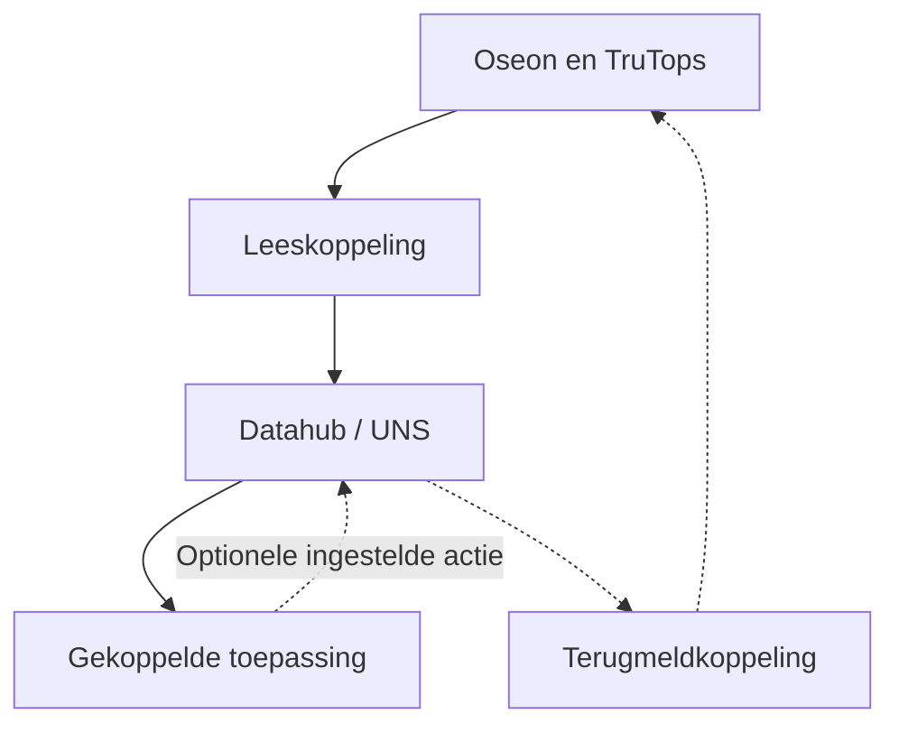

Oseon2UNS brengt productiegegevens uit TRUMPF Oseon en TruTops naar een datahub. Gekoppelde toepassingen kunnen dezelfde broninformatie gebruiken zonder elk een eigen verbinding met Oseon te bouwen.

[English](/oseon2uns/overview)

## Hoe de koppeling werkt

De koppeling leest ondersteunde TRUMPF-interfaces en geselecteerde gegevens uit de database zonder daarin te schrijven. Daarna zet zij beschikbare informatie op de unified namespace (UNS). Een aangesloten toepassing haalt daar gegevens op. Een aparte, optionele terugroute kan geselecteerde acties naar Oseon sturen.

Afhankelijk van de bronnen en inrichting gaat het om orders, bewerkingen, onderdelen, machinegegevens en voorraad. Oseon blijft de bron van de daar gelezen gegevens. Een toepassing heeft eigen schermen en logica nodig om die gegevens te tonen of gebruiken.

## De optionele terugroute

Als de route is ingericht en de installatie het ondersteunt, kan een toepassing geselecteerde productieterugmeldingen sturen, zoals een bewerking starten, aantallen melden of een bewerking afronden. Andere acties kunnen per installatie worden ingericht. De toepassing stuurt een verzoek via de datahub; de koppeling gebruikt de Oseon-interface en geeft een resultaat terug. Ontvangst bewijst nog niet dat Oseon de wijziging heeft verwerkt.

Een inrichting die alleen leest, heeft de terugmeldkoppeling niet nodig. Beschikbare gegevens en acties hangen af van de TRUMPF-interfaces, toepassing en afgesproken inrichting. De koppeling levert geen standaard bedienscherm mee.

[Volg het proces](/nl/oseon2uns/workflow) · [Oseon2UNS op de website](https://sheetmetalconnect.com/integratie-oseon2uns)
