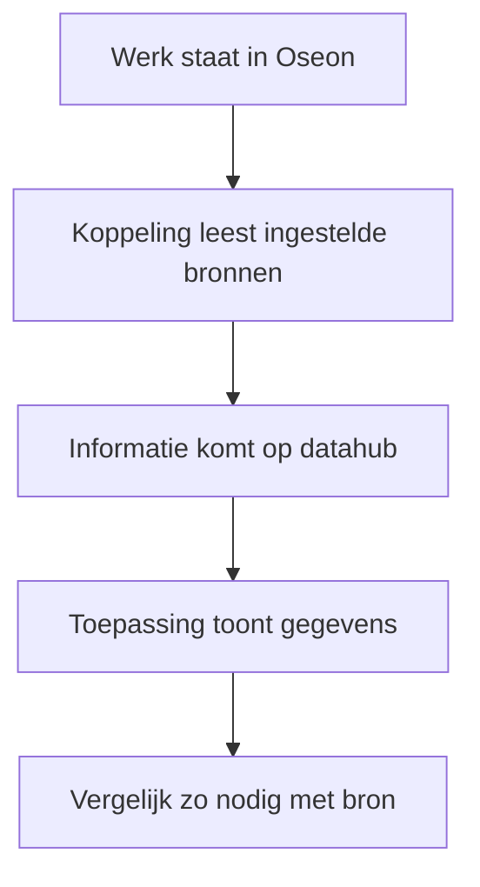
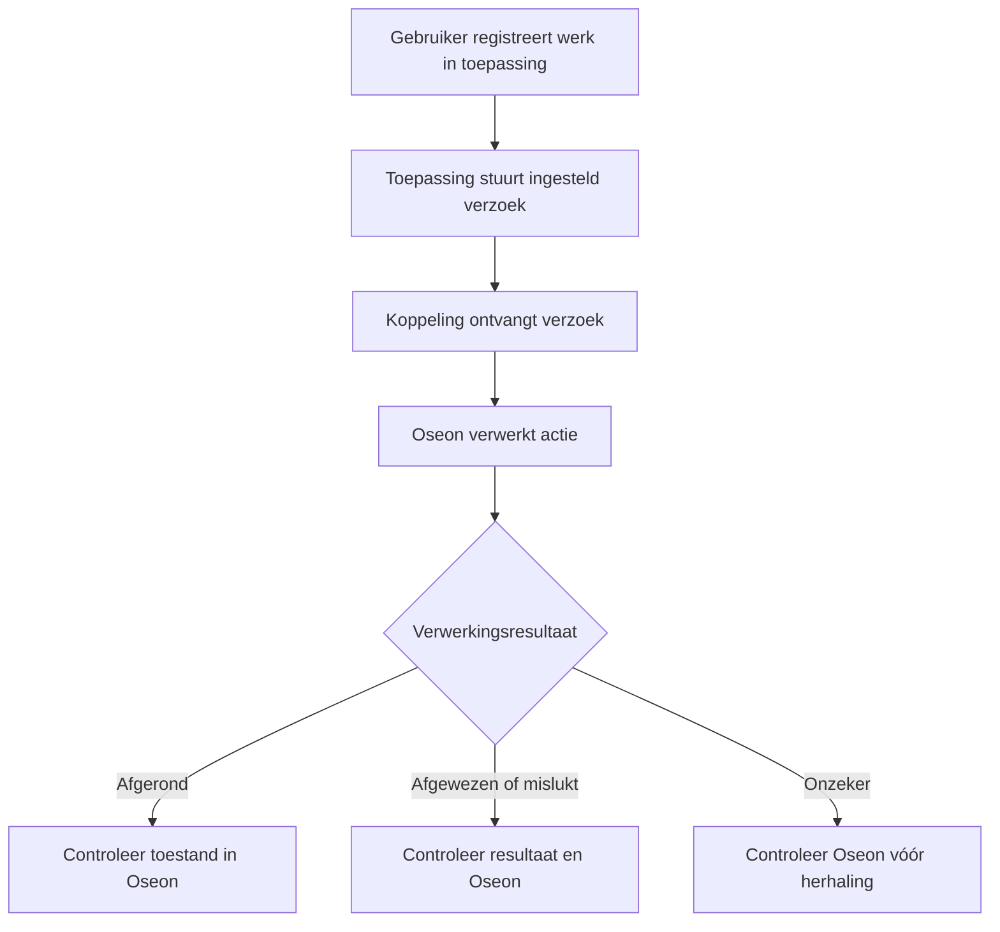

Oseon2UNS brengt de afgesproken brongegevens naar de datahub. Wat iemand ziet en kan doen, hangt af van de toepassing en de bijbehorende rechten.

[English](/oseon2uns/workflow) · [Overzicht](/nl/oseon2uns/overview)

## Volg productiegegevens

1. Open de gekoppelde toepassing en zoek de order of bewerking met de getoonde referentie.
2. Controleer de getoonde gegevens. Velden en verversing verschillen per toepassing.
3. Vergelijk een onverwachte waarde met het bronrecord in Oseon.

## Meld werk terug als dat is ingericht

1. Registreer werk met de gewone bediening van de toepassing, als de actie is ingeschakeld. Dat kan een bewerking starten, een aantal melden of een bewerking afronden zijn.
2. Controleer het verwerkingsresultaat in het gekoppelde systeem.
3. Controleer de toestand in Oseon. De toepassing bepaalt de bediening en rechten.

Een ontvangstmelding betekent dat het verzoek bij de koppeling is aangekomen. Dat bewijst niet dat de actie in Oseon is geslaagd. Controleer het verwerkingsresultaat en de toestand in Oseon. Is het resultaat onzeker, stel dan eerst vast wat werkelijk is gebeurd voordat de actie opnieuw wordt aangeboden.

## Als informatie ontbreekt

Controleer of de order of bewerking in Oseon bestaat en of de toepassing het juiste record toont. De inrichting bepaalt welke brongegevens beschikbaar zijn. Ontbreekt een terugmeldresultaat of is het onduidelijk, geef support de order- en bewerkingsreferentie en controleer Oseon voordat de actie wordt herhaald. Een toepassing kan een deel van de brongegevens tonen.
