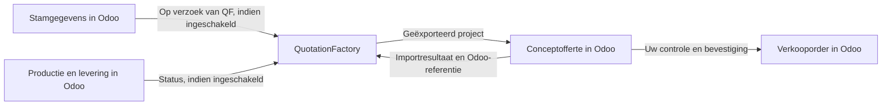

QF2Odoo neemt een geëxporteerd QuotationFactory-project over als **conceptofferte** in Odoo, met artikelen, stuklijsten, bewerkingen en bijlagen. Uw team controleert het resultaat in Odoo voordat het de order bevestigt.

[English](/qf2odoo/overview)

## Welk systeem beheert wat?

| Gegeven of beslissing | Waar het thuishoort |
| --- | --- |
| Calculatieproject, berekening en bronbestanden | QuotationFactory |
| Stamgegevens van klanten, leveranciers en catalogusartikelen | Odoo |
| Controle van de geïmporteerde offerte en orderbevestiging | Odoo |
| Productie, levering, facturatie en betalingsverwerking | Odoo |

De productiegegevens kunnen stuklijsten met meerdere niveaus, bewerkingen en tekeningen bevatten. De offerte blijft een concept tot de gebruikelijke bevestiging in Odoo. De status **Ordered** in QuotationFactory bevestigt de Odoo-offerte niet en maakt geen productievraag aan.

Na een geslaagde import gaan het resultaat en de Odoo-offerte- of orderreferentie terug naar QuotationFactory. Dit antwoord hoort bij de basisimport en staat los van optionele productiestatussen.

## Optionele terugkoppelingen

Als dit is ingericht, kan QuotationFactory momentopnamen van stamgegevens uit Odoo opvragen. Ook productie- en leverstatussen kunnen terug naar QuotationFactory. Dit zijn afgebakende uitwisselingen, geen onbeperkte synchronisatie van beide systemen.

De connector automatiseert geen factuuraanmaak, inning of aflettering van betalingen.

## Verder lezen

Lees de [dagelijkse werkwijze](/nl/qf2odoo/workflow), bekijk de [instellingen en opties](/nl/qf2odoo/settings) of zoek hulp bij een [ontbrekend resultaat](/nl/qf2odoo/troubleshooting).

Voor commerciële informatie kunt u naar [QF2Odoo op de website](https://sheetmetalconnect.com/integratie-qf2odoo).
