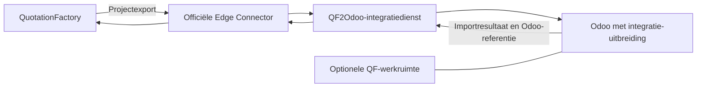
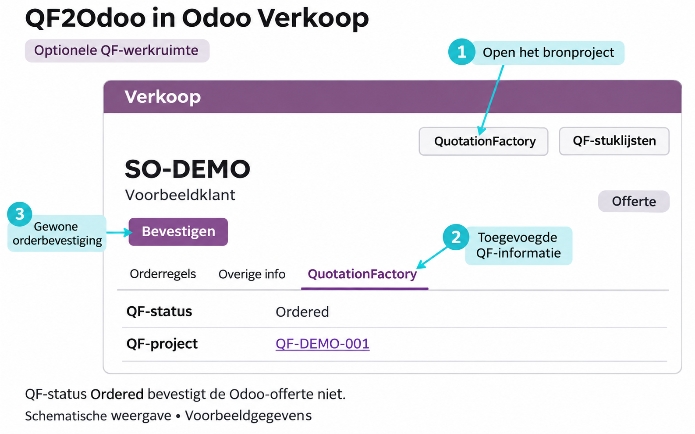

QF2Odoo brengt een calculatie uit QuotationFactory naar Odoo. De koppeling maakt een **conceptofferte** met artikelen, stuklijsten, bewerkingen en bijlagen. Verkoop en werkvoorbereiding hoeven die productstructuur daardoor niet opnieuw in te voeren.

[English](/qf2odoo/overview)

## Wat lost de koppeling op?

In QuotationFactory ligt vast wat is gecalculeerd. Odoo heeft die gegevens nodig voor de offerte en de verdere orderverwerking.

QF2Odoo draagt het geëxporteerde project over. Het team controleert de conceptofferte en bevestigt de order in Odoo. Daarna volgen de gebruikelijke processen voor productie, levering, facturatie en betaling.

## Uit welke onderdelen bestaat QF2Odoo?

| Onderdeel | Functie |
| --- | --- |
| QuotationFactory met de officiële Edge Connector | Levert het geëxporteerde calculatieproject aan en ontvangt antwoorden. |
| QF2Odoo-integratiedienst | Verwerkt de uitwisseling tussen QuotationFactory en Odoo. |
| Vereiste integratie-uitbreiding in Odoo | Ondersteunt de import en legt de QF-brongegevens vast bij de betreffende registraties. |
| Optionele QF-werkruimte in Odoo | Voegt projectoverzichten, schermen en rapporten toe voor het terugvinden en volgen van QF-werk. |

De koppeling bouwt voort op de officiële Edge-uitwisseling van QuotationFactory. De Edge Connector verzorgt de verbinding met QuotationFactory; de integratiedienst verwerkt de overdracht en de Odoo-uitbreiding zorgt voor de registratie in Odoo. De werkruimte en aanvullende uitwisselingen zijn apart toe te voegen. Een UNS is voor deze directe koppeling niet nodig.

Na bevestiging bepalen de voorraad- en aanvullingsregels van Odoo hoe het werk verdergaat. Geïmporteerde maakartikelen gebruiken productie en aanvulling op bestelling; bestaande inkoopartikelen behouden hun Odoo-routes. Ook een expliciet ingerichte uitbestedingsroute is mogelijk.

## Hoe lopen de gegevens?

De import kan ook stuklijsten met meerdere niveaus, bewerkingen en tekeningen bevatten.

Na een geslaagde import gaan het resultaat en de Odoo-offerte- of orderreferentie terug naar QuotationFactory. Dit antwoord hoort bij de basiswerking.

### Optionele uitwisseling terug naar QuotationFactory

- **Stamgegevens:** QuotationFactory vraagt de ingeschakelde klant-, leveranciers- of artikelgegevens uit Odoo op.
- **Statussen:** productie- en leverstatussen gaan volgens de ingerichte koppelingen terug.

Een wijziging in Odoo wordt dus niet direct overal gesynchroniseerd. De uitwisseling volgt de ingeschakelde functies en afgesproken momenten.

## Wat verandert er zichtbaar in Odoo?

De offerte blijft een Odoo-offerte. De integratie voegt broninformatie toe:

- **QF-broninformatie** bij offertes en artikelen, als brongegevens zijn aangeleverd.
- **QF-productie-instructies** bij productieorders en werkorders, als instructies zijn meegegeven.

De brongegevens zijn alleen-lezen. Opmerkingen voor de klant kunnen op de offerte worden afgedrukt. Interne productie- en uitbestedingsinstructies worden niet op de klantofferte afgedrukt.

### Met de optionele QF-werkruimte

Onder **Verkoop → Orders → QF-projecten** staan de geïmporteerde projecten. Het tabblad **QuotationFactory** toont de bronkoppeling, importgegevens en QF-status.

De knoppen **QuotationFactory**, **QF-stuklijsten** en **Productie** geven toegang tot de gekoppelde gegevens. Bij lopende productie kunnen ook **Productievoortgang**, **Nu bij** en **Geboekte uren** zichtbaar zijn. Bij nieuwe projecten zijn de productiegroepen nog verborgen.

<Frame caption="Illustratie van de optionele QF-werkruimte met voorbeeldgegevens. De indeling kan per inrichting verschillen.">
  
</Frame>

## Wat blijft standaard Odoo?

Odoo blijft verantwoordelijk voor:

- Controle van de offerte en bevestiging van de verkooporder.
- Inkoop, werkvoorbereiding en productie.
- Levering, facturatie en betalingsverwerking.

<Note>
  **Ordered** in QuotationFactory bevestigt de Odoo-offerte niet en maakt geen productievraag aan. QF2Odoo automatiseert ook geen factuuraanmaak, inning of aflettering van betalingen.
</Note>

## Aan de slag

Volg [de order van calculatie tot betaling](/nl/qf2odoo/workflow). De [instellingen](/nl/qf2odoo/settings) beschrijven de opties. Bij ontbrekende gegevens helpt [problemen oplossen](/nl/qf2odoo/troubleshooting).

De [productpagina van QF2Odoo](https://sheetmetalconnect.com/integratie-qf2odoo) beschrijft de mogelijkheden en de inrichting.
