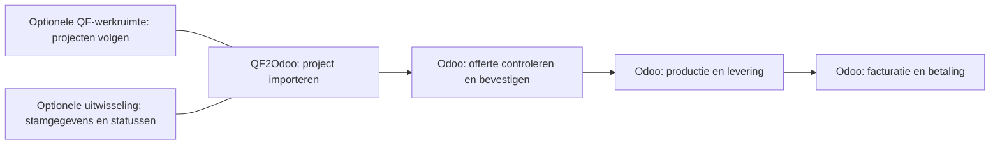

De offerte-import is de basis van QF2Odoo. De werkruimte, uitwisseling van stamgegevens en statusterugmelding zijn afzonderlijk in te richten. De beheerder kan aangeven welke functies voor het bedrijf aanstaan.

[English](/qf2odoo/settings)

## Welke functies zijn beschikbaar?

| Functie | Wat gebruikers ervan zien |
| --- | --- |
| Offerte-import | Een conceptofferte met product- en productiegegevens uit het geëxporteerde project. |
| Optionele werkruimte | QF-projectoverzichten, bronkoppelingen en de gekoppelde exporthistorie. |
| Optionele stamgegevensuitwisseling | Klanten, leveranciers of catalogusartikelen uit Odoo, op verzoek van QF. |
| Optionele statusterugmelding | Productie- en leverstatussen uit Odoo volgens de ingerichte koppelingen. |

<Note>
  Een wijziging in Odoo werkt niet direct door in QF. De uitwisseling van stamgegevens begint wanneer QF een nieuwe momentopname opvraagt.
</Note>

## Wat doet de koppeling, wat doet Odoo?

De opties hieronder veranderen de uitwisseling en de zichtbare QF-gegevens. Orderbevestiging en de verdere afhandeling blijven de gebruikelijke Odoo-processen.

## Commerciële portaalgegevens beschermen

Met de werkruimte geïnstalleerd staat onder **Verkoop → Instellingen → QuotationFactory** de instelling **Commerciële inhoud van QF-portaal beschermen**.

Deze instelling staat standaard per bedrijf aan. Op conceptoffertes en verzonden offertes kunnen gewone gebruikers de commerciële inhoud uit het portaal dan niet wijzigen.

Wel mogelijk blijven:

- Gegevens voor verzending en werkvoorbereiding aanpassen.
- De offerte via de gebruikelijke werkwijze bevestigen.

## Prijzen en eenheden afspreken

Voor artikelstamgegevens is de prijsbron instelbaar:

- Leveranciersprijs, met kostprijs als terugval.
- Kostprijs.

Controleer de gekozen prijsbron bij prijsverschillen tussen QF en Odoo.

### Van vierkante meter naar plaat

Plaatprijzen en staffels kunnen in Odoo per vierkante meter zijn vastgelegd. Met expliciete plaatafmetingen kan QF2Odoo die omrekenen naar prijzen per plaat voor QF.

De stamgegevens in Odoo blijven daarbij ongewijzigd.

## Optionele controle bij levering

Sommige installaties hebben een extra controle vóór het afronden van een levering. De beheerder richt deze optie in. Het is geen standaardstap voor iedere gebruiker.

Bij een ontbrekend of onverwacht resultaat helpt de pagina [problemen oplossen](/nl/qf2odoo/troubleshooting).
