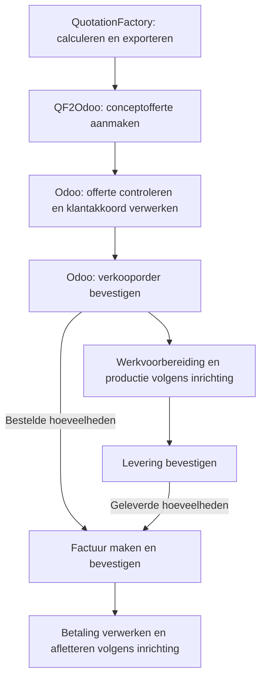
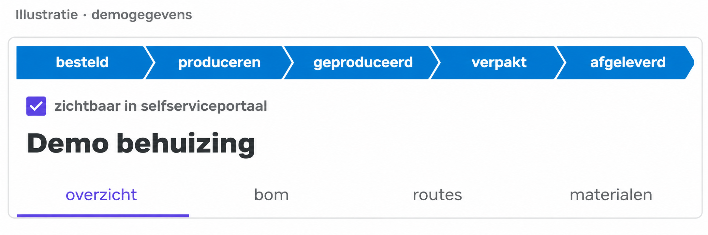
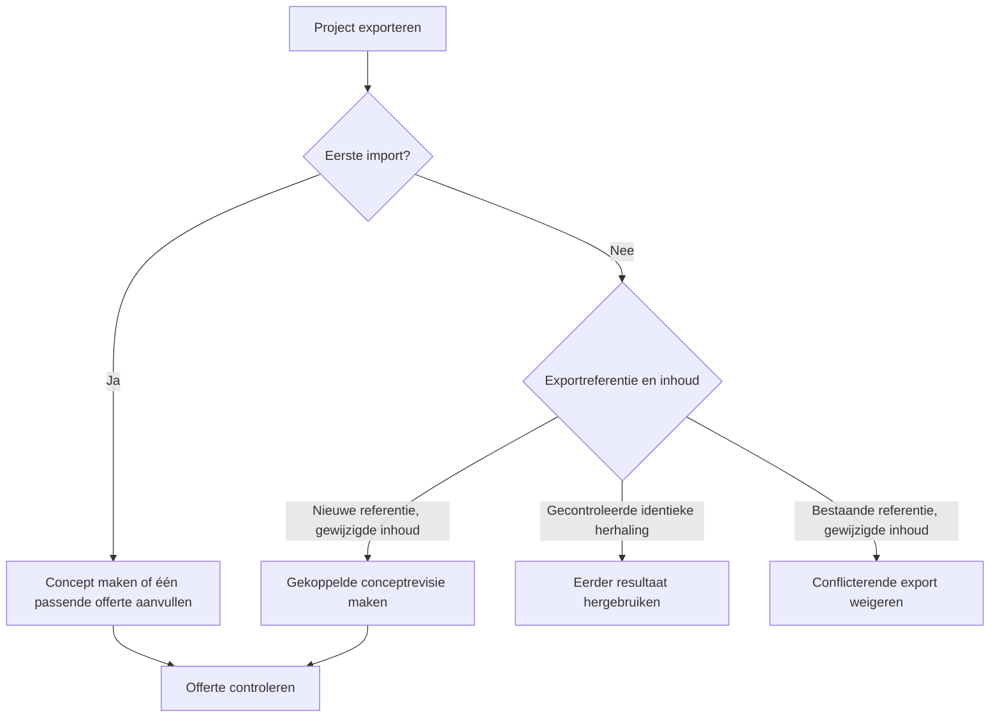

QF2Odoo draagt de calculatie uit QuotationFactory over aan Odoo. Daarna loopt de order verder via de gebruikelijke Odoo-processen: klantakkoord, orderbevestiging, productie, levering, factuur en betaling.

[English](/qf2odoo/workflow)

Kies de situatie die bij de aanvraag past:

<CardGroup cols={2}>
  <Card title="Aanvraag via het klantportaal" icon="user" href="#de-klant-gebruikt-het-portaal">De klant start de aanvraag in QF.</Card>
  <Card title="Aanvraag per e-mail of intern" icon="envelope" href="#een-aanvraag-komt-per-e-mail-binnen-of-ontstaat-intern">Een medewerker maakt het QF-project.</Card>
  <Card title="Onderdeel of samenstelling voorbereiden" icon="gears" href="#een-onderdeel-of-samenstelling-voorbereiden">Bekijk technische gegevens vóór bevestiging.</Card>
  <Card title="Een offerte wijzigen" icon="clock-rotate-left" href="#een-gewijzigde-export-verwerken">Bekijk wat een gewijzigde export doet.</Card>
</CardGroup>

Zie [geïmporteerde gegevens](/nl/qf2odoo/imported-data) voor vindplaatsen, voorwaarden en beheer.

## Het hele proces

Het facturatiebeleid bepaalt wanneer aantallen factureerbaar zijn. Bij **Bestelde hoeveelheden** kan dat al na orderbevestiging. Bij **Geleverde hoeveelheden** is een bevestigde levering nodig.

## Waar begint de aanvraag?

Een klant kan een aanvraag starten in het QuotationFactory-portaal. Een medewerker kan ook zelf een project opzetten en calculeren. Beide routes komen samen bij de ingestelde QF-export. De koppeling leest geen binnenkomende e-mail en maakt daar geen project van.

### De klant gebruikt het portaal

<Steps>
  <Step title="Klant: start de aanvraag">De klant maakt een aanvraag in het QF-portaal.</Step>
  <Step title="Medewerker: calculeer en exporteer">Beoordeel en calculeer het project in QuotationFactory. Gebruik de ingestelde exportwerkwijze.</Step>
  <Step title="Medewerker: controleer de Odoo-offerte">Na import staat de Odoo-referentie bij het QF-project. Open en controleer het concept in Odoo.</Step>
  <Step title="Medewerker: verwerk het akkoord">Verwerk het klantakkoord volgens het eigen verkoopproces voordat de offerte in Odoo wordt bevestigd.</Step>
</Steps>

Het selectievakje voor zichtbaarheid bepaalt of de klant het project in QF kan zien. Dat staat los van de bronmarkering die aangeeft dat het project in het portaal is aangemaakt. Met de optionele Odoo-werkruimte en de standaard ingeschakelde bescherming zijn commerciële velden van portaaloffertes in concept of verzonden voor gewone gebruikers alleen-lezen. Verzending en werkvoorbereiding blijven bewerkbaar. Zichtbaarheid en bescherming zijn geen bewijs van klantakkoord.

### Een aanvraag komt per e-mail binnen of ontstaat intern

<Steps>
  <Step title="Medewerker: maak en calculeer">Maak en calculeer een project in QuotationFactory op basis van de aanvraag en tekeningen.</Step>
  <Step title="Medewerker: exporteer">Gebruik de ingestelde QF-export. De koppeling leest de e-mail niet en maakt het project niet zelf aan.</Step>
  <Step title="Medewerker: controleer in Odoo">Open de conceptofferte met de teruggegeven referentie. Controleer die en verwerk het akkoord vóór bevestiging.</Step>
</Steps>

Een project van een medewerker wordt niet automatisch een portaalproject doordat het zichtbaar wordt gemaakt voor de klant.

### Een onderdeel of samenstelling voorbereiden

Een project kan bestaan uit een enkel maakdeel of uit een samenstelling met meerdere niveaus. Bij import maakt QF2Odoo revisiespecifieke Odoo-artikelen, stuklijsten en bewerkingen aan, samen met de conceptofferte. Medewerkers kunnen die gegevens vóór orderbevestiging bekijken. De import zelf maakt geen productie- of voorraadbehoefte aan.

De beschreven export importeert een project met een offerte. Een aparte import van alleen artikelen of stuklijsten, los van een offerte, is niet beschreven als ondersteunde werkwijze. Na bevestiging gelden de normale inkoop- en productieregels van Odoo.

<Frame caption="Illustratieve QF-projectkop met demogegevens.">
  
</Frame>

De ingestelde terugmelding omvat produceren, geproduceerd en afgeleverd, niet verpakt.

### Het project in beide systemen volgen

QuotationFactory beheert het project, de calculatie, de zichtbaarheid voor de klant en de projectstatussen. Odoo beheert klanten en catalogusartikelen, orderbevestiging, productie en levering. In QF wordt ingesteld bij welke projectstatussen een export plaatsvindt; QF2Odoo filtert imports niet op status. Na een geslaagde import gaat de Odoo-referentie terug naar QF.

Als statusterugmelding is ingeschakeld, stuurt Odoo de ingestelde productie- en leverstatussen terug naar QF. Statussen zoals verpakken kunnen in QF worden bijgehouden; de koppeling meldt geen verpakkingsstatus automatisch terug. Het portaal toont het QF-project volgens de zichtbaarheidsinstelling, geen live Odoo-scherm. Controleer aantallen en klantakkoord in het systeem waar ze worden vastgelegd.

## Calculatie en offerte

<Steps>
  <Step title="Exporteer het calculatieproject">
    Rond het project af in QuotationFactory. Gebruik de exportwerkwijze die voor het bedrijf is ingericht.

    Bewaar de projectreferentie. Na een geslaagde import meldt QF2Odoo het resultaat en de Odoo-offerte- of orderreferentie terug.
  </Step>
  <Step title="Zoek en controleer de conceptofferte">
    Open de geïmporteerde offerte in Odoo. Met de optionele werkruimte staan de projecten onder **Verkoop → Orders → QF-projecten**.

    Vergelijk de gegevens met het QuotationFactory-project:

    - Klant, aantallen, prijzen en commerciële afspraken.
    - Artikelen, stuklijsten en bewerkingen.
    - Tekeningen en andere bijlagen.

    De import voegt een notitie met een koppeling naar het QF-project toe aan het berichtenoverzicht bij de offerte.

    Op het tabblad **QF-broninformatie** staan de aangeleverde brongegevens. Met de optionele werkruimte toont **QuotationFactory** ook de importgegevens en bronkoppeling.
  </Step>
</Steps>

De beschikbare tabbladen hangen af van de aangeleverde gegevens en geïnstalleerde onderdelen. Bij ingeschakelde bescherming blijven commerciële portaalgegevens beschermd tegen gewone gebruikerswijzigingen. Zie [instellingen](/nl/qf2odoo/settings).

## Van order naar levering

<Steps>
  <Step title="Verwerk klantakkoord en bevestig de order">
    Verwerk het klantakkoord volgens het ingerichte verkoopproces. Bij handmatige bevestiging zet **Bevestigen** de offerte om in een verkooporder.

    Een onvolledige QF-import blokkeert deze bevestiging. Rond de import eerst af.
  </Step>
  <Step title="Bereid het werk voor en volg de productie">
    Odoo volgt na orderbevestiging de ingerichte inkoop- en productieregels. Open de bijbehorende productieorders en werkorders om het werk voor te bereiden en uit te voeren.

    Aangeleverde instructies staan onder **QF-productie-instructies**. Met de optionele werkruimte geven **QF-stuklijsten** en **Productie** toegang tot de gekoppelde gegevens.

    Er is geen afzonderlijke QF-knop om productie vrij te geven.
  </Step>
  <Step title="Bevestig de werkelijke levering">
    Open de levering vanuit de verkooporder. Controleer de werkelijk geleverde aantallen en bevestig de levering via de gebruikelijke Odoo-werkwijze.

    Controleer bij een deellevering ook wat nog openstaat. Een teruggestuurde QF-status vervangt die controle niet.
  </Step>
</Steps>

<Note>
  **Ordered** in QuotationFactory bevestigt de Odoo-offerte niet en maakt geen productievraag aan. De bescherming van commerciële portaalgegevens is evenmin een bewijs van klantakkoord.
</Note>

## Factuur en betaling

Dit zijn standaardfuncties van Odoo. QF2Odoo maakt of bevestigt geen facturen en verwerkt geen betalingen.

<Steps>
  <Step title="Maak en controleer de factuur">
    Kies op de verkooporder **Factuur maken** en daarna **Concept maken**. Welke aantallen beschikbaar zijn, hangt af van het facturatiebeleid van het artikel.

    Controleer de conceptfactuur, waaronder klant, aantallen, prijzen en betalingsvoorwaarden. **Bevestigen** boekt de factuur en kent een factuurnummer toe. Een conceptfactuur heeft nog geen boekhoudkundig effect.

    Verstuur de bevestigde factuur volgens de ingerichte verzendwijze.
  </Step>
  <Step title="Verwerk de betaling en controleer de aflettering">
    Volg de ingerichte betaal- en bankwerkwijze. Voor een handmatige betalingsregistratie staat op de klantfactuur **Betaal**.

    Controleer dagboek, betaaldatum, betaalmethode en bedrag. Kies daarna **Betaling aanmaken**.

    Controleer vervolgens of de betaling of factuur aan de juiste banktransactie is gekoppeld en of het openstaande bedrag klopt.
  </Step>
</Steps>

<Note>
  Een geregistreerde betaling betekent niet altijd dat de factuur direct **Betaald** is. Vaak blijft de status **In betaling** tot de bankaflettering. De rekening- en betaalinrichting bepaalt de precieze verwerking.
</Note>

De officiële Odoo 19-handleiding beschrijft het [facturatiebeleid](https://www.odoo.com/documentation/19.0/applications/sales/sales/invoicing/invoicing_policy.html), de [klantfacturen](https://www.odoo.com/documentation/19.0/applications/finance/accounting/customer_invoices.html) en de [betalingsverwerking](https://www.odoo.com/documentation/19.0/applications/finance/accounting/payments.html).

## Welke status gaat terug naar QuotationFactory?

Bij ingeschakelde statusterugmelding gelden standaard deze koppelingen:

| Gebeurtenis in Odoo | Status in QuotationFactory |
| --- | --- |
| Productie is gestart | Produceren (Producing) |
| Alle niet-geannuleerde productieorders zijn gereed | Geproduceerd (Produced) |
| Een uitgaande levering is gevalideerd | Afgeleverd (Delivered) |

**Afgeleverd** kan al volgen op een deellevering. Controleer de werkelijke geleverde aantallen in Odoo.

Een status kan teruggaan als de voortgang in Odoo verandert. Facturatie en betalingen blijven afzonderlijke processen.

## Een gewijzigde export verwerken

| Situatie bij export | Resultaat in Odoo |
| --- | --- |
| Eerste import met één overeenkomende conceptofferte of verzonden offerte | De koppeling kan die offerte aanvullen. Bij meerdere overeenkomsten stopt de import. |
| Gewijzigde inhoud met een nieuwe exportreferentie | Een gekoppelde conceptrevisie ontstaat, ook na een verzonden offerte of bevestigde order. |
| Gecontroleerde identieke herhaling | Het eerdere geaccepteerde resultaat wordt opnieuw gebruikt, zonder nieuwe revisie. |
| Gewijzigde inhoud onder een bestaande exportreferentie | De conflicterende export wordt geweigerd. |

<Warning>Een nieuw concept verandert de eerdere bevestigde order of productievraag niet. Controleer het actuele concept en bevestig het via het normale Odoo-proces.</Warning>

Ontbreekt de verwachte revisie? Zie [problemen oplossen](/nl/qf2odoo/troubleshooting).
