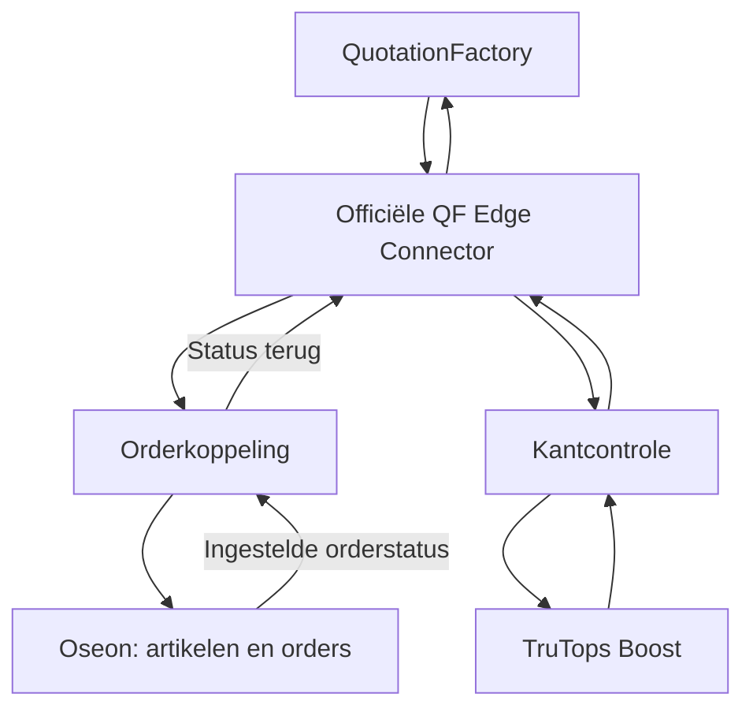

QF2Oseon verbindt QuotationFactory met TRUMPF Oseon en TruTops Boost. Projectgegevens gaan naar de werkvoorbereiding en het resultaat van een kantcontrole komt terug bij de calculatie.

[English](/qf2oseon/overview)

## Kies wat je wilt doen

<CardGroup cols={2}>
  <Card title="Een kantdeel controleren" icon="check" href="/nl/qf2oseon/workflow#controleer-een-kantdeel">Beoordeel het Boost-resultaat in QuotationFactory.</Card>
  <Card title="Artikelen voorbereiden" icon="gears" href="/nl/qf2oseon/workflow#kies-de-route">Breng geschikte artikelen naar Oseon, met of zonder klantorder.</Card>
  <Card title="Een order overdragen" icon="clipboard" href="/nl/qf2oseon/workflow#draag-een-order-over-en-controleer-die">Exporteer het project en controleer het resultaat in Oseon.</Card>
  <Card title="Gegevens en revisies controleren" icon="list-check" href="/nl/qf2oseon/workflow#welke-gegevens-komen-in-oseon">Bekijk welke gegevens meegaan en wat na een wijziging aandacht vraagt.</Card>
</CardGroup>

## Hoe de koppeling werkt

De officiële Edge Connector van QuotationFactory wisselt bestanden uit met twee integratiediensten. De orderkoppeling brengt projectgegevens naar Oseon. De aparte Boost-koppeling vraagt kantberekeningen aan en geeft resultaten terug aan QuotationFactory.

Voor artikelen gebruikt de koppeling de TRUMPF-interface; klantorders gaan via de importinterface van Oseon. Voor de kantcontrole is een ingerichte Boost-omgeving nodig met de juiste machines en gereedschappen. Welke routes beschikbaar zijn, hangt af van de inrichting.

## De rol van elk systeem

In QuotationFactory staan de calculatie en het project. Oseon beheert de overgenomen productiegegevens en het vervolg van het werk. Boost berekent een kantoplossing met de ingestelde machine en gereedschappen. De koppeling draagt gegevens over en vertaalt die; controle in de toepassingen blijft nodig.

De orderroute kan artikelen, werkplannen en klantorders aanmaken. Tekeningen en andere bijlagen gaan mee volgens de ingerichte uitwisseling. Een vertaaltabel koppelt bewerkingen uit QuotationFactory aan bestaande werkplekken en bewerkingen in Oseon.

[Volg het proces](/nl/qf2oseon/workflow) · [QF2Oseon op de website](https://sheetmetalconnect.com/integratie-qf2oseon)
