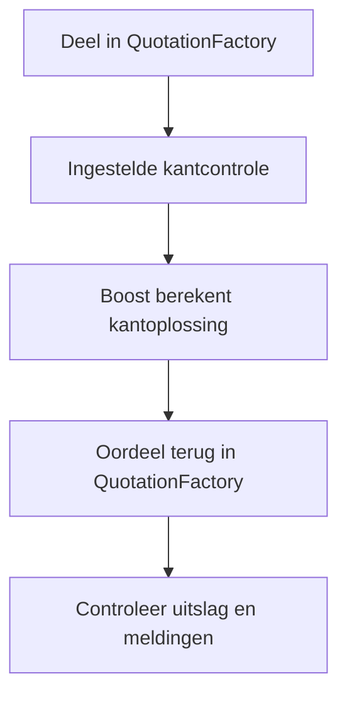
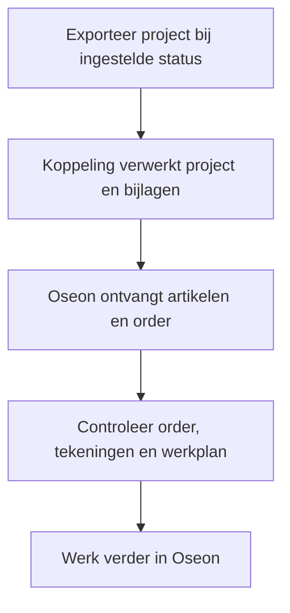

De calculatie begint in QuotationFactory. Controleer de overgenomen gegevens in Oseon voordat het werk naar productie gaat. De actieve routes en exportstatus hangen af van de inrichting.

[English](/qf2oseon/workflow) · [Overzicht](/nl/qf2oseon/overview)

## Controleer een kantdeel

Boost berekent een kantoplossing met de ingestelde machine en gereedschappen. QuotationFactory ontvangt het oordeel en de meldingen. Als een instelrapport beschikbaar is, kan dat meekomen. Een deel kan maakbaar, maakbaar met waarschuwing of niet maakbaar zijn. De controle informeert en blokkeert niet. Een gebruiker kan in QuotationFactory handmatig afwijken van het oordeel. Dat is een menselijke keuze, geen nieuwe Boost-berekening.

## Draag een order over en controleer die

1. Rond het project in QuotationFactory af en zet het op de afgesproken exportstatus.
2. Open de order en artikelen in Oseon. Vergelijk aantallen, materiaal, tekeningen en werkplan met het project.
3. Vul ontbrekende gegevens aan voordat de werkvoorbereiding verdergaat. Order en werkplan moeten aansluiten op het project.

Controleer de bestaande order in Oseon voordat een gewijzigd project opnieuw wordt geëxporteerd. Stel vast welke wijzigingen nodig zijn. Oseon bepaalt hoe de import een herhaalde order behandelt; een nieuwe export werkt de order niet noodzakelijk bij en voorkomt niet vanzelf dubbele orders.

Oseon verwerkt de orderimport zelf. Een bestand bij de importinterface bewijst nog niet dat de order compleet of productiegereed is. Als statusfeedback is ingericht, kan Oseon voortgang teruggeven aan QuotationFactory.

## Als een resultaat ontbreekt

Controleer de projectstatus en of de betreffende Edge Connector verbonden is. Ontbreekt een artikel, controleer materiaal en projectgegevens. Kijk bij een ontbrekende bewerking naar de vertaaltabel en de Oseon-bewerking. Ontbreekt een kantresultaat, controleer het STEP-bestand en of de controle aanstaat. Met het project- of ordernummer kan support de verwerking terugzoeken.
