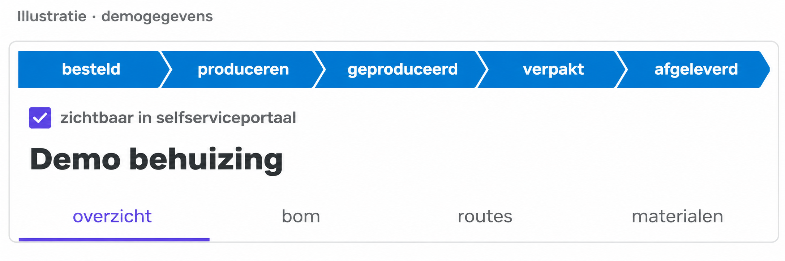
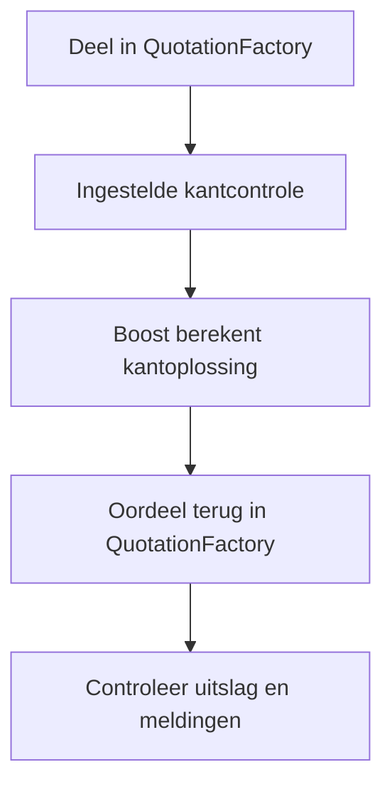
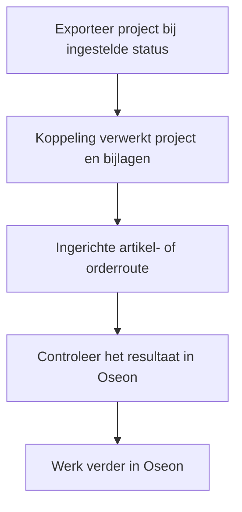

De calculatie begint in QuotationFactory. Controleer de overgenomen gegevens in Oseon voordat het werk naar productie gaat. De actieve routes en exportstatus hangen af van de inrichting.

[English](/qf2oseon/workflow) · [Overzicht](/nl/qf2oseon/overview)

<Frame caption="Illustratie met demogegevens: de statusbalk en portaalzichtbaarheid in een QF-project.">
  
</Frame>

De labels tonen mogelijke stappen. Controleer de werkelijke projectstatus en de ingestelde terugmeldroute.

## Kies de route

Een klant kan een aanvraag starten in het portaal van QuotationFactory. Een medewerker kan ook een aanvraag die per e-mail binnenkomt als project invoeren. In beide gevallen vindt de calculatie en beoordeling plaats in QuotationFactory. Een zichtbaar project in het portaal betekent op zichzelf niet dat de klant een order heeft geplaatst of geaccepteerd.

| Situatie | Wat gebeurt er? |
| --- | --- |
| Controle voor de offerte | De ingestelde Boost-controle geeft het oordeel terug aan QuotationFactory. Dit staat los van de orderexport naar Oseon. |
| Artikelen voorbereiden zonder klantorder | Als artikelverwerking en export bij **Quoted** zijn ingericht, kunnen geschikte artikelen zonder klantorder naar Oseon. In een inrichting met alleen artikelverwerking gebeurt dit ook bij exports met Ordered of Producing. Controleer de artikelen voordat je ze opnieuw gebruikt. |
| Klantorder | Na export van een project met status **Ordered** (besteld) verwerkt de koppeling geschikte artikelen en maakt zij, indien ingeschakeld, een klantorder klaar voor import in Oseon. |
| Productieorder | Een export bij **Producing** (in productie) kan ook productieorders klaarzetten als die route is ingeschakeld. |

De exportmomenten van de QF Edge Connector en de actieve routes hangen af van de inrichting. Controleer na de ingestelde export het bijbehorende resultaat in Oseon.

## Losse delen en samenstellingen

De klantorderimport maakt een positie voor elk deel in de geëxporteerde stuklijst, met het totale aantal voor het project. Dit is een delenlijst: ga er niet van uit dat geneste samenstellingen of subsamenstellingen als structuur in Oseon worden opgebouwd. Vergelijk posities en aantallen met het project in QuotationFactory. De keuze van het werkplan hangt af van de bewerkingen en de inrichting.

De artikelinterface verwerkt geschikte plaatdelen met een snijbewerking. Buizen volgen een aparte route als die is ingericht. Inkoop- en materiaalartikelen kunnen op de order voorkomen, maar een orderpositie betekent niet vanzelf dat ook een artikel in Oseon is aangemaakt. Controleer de beschikbaarheid van artikelen en materiaal in Oseon.

## Welke gegevens komen in Oseon?

| Bestemming | Gegevens uit het QF-project | Controle in Oseon |
| --- | --- | --- |
| Artikelstam, via de artikelinterface | Geschikte plaatdelen met snijbewerking: artikelnummer en omschrijving, tekeningnummer en revisie, gekozen materiaal, CAD-verwijzing en ingestelde werkplanstappen en documenten. | Controleer artikel, materiaal, tekening en de gekoppelde bewerkingen. Een bewerking zonder vertaaltabel kan ontbreken. |
| Klantorder, via de orderimport | Project-ID en referentie, klant en adres, leveringsconditie en per geëxporteerd deel een positie met artikelnummer, aantal, stuksprijs, materiaal, gewenste datum en ingesteld werkplan. | Controleer de order en posities na import. Controleer het bijbehorende artikel apart. |
| Productieorder, indien ingeschakeld | Artikelnummer, projectaantal, klant en materiaal per geëxporteerd deel, met een productiewerkplan. | Controleer de geïmporteerde productieorders, datums en aantallen. |
| Buisartikel, indien ingeschakeld | Buisgegevens via de bestandsimport van Oseon; CAD-bestanden volgen de ingerichte buisroute. | Controleer het buisartikel en de productiegegevens. |

### Voor de export

Controleer bij plaatdelen het artikelnummer en gekozen materiaal en zorg dat de benodigde bewerkingen aan Oseon zijn gekoppeld. De ingestelde validatie bepaalt of ontbrekend materiaal of een andere fout alleen wordt gemeld of dat het deel niet wordt verstuurd. CAD- en tekeningbestanden moeten in het project aanwezig zijn en door de ingerichte uitwisseling worden ondersteund. Documenten aan bewerkingen koppelen is optioneel. Werkplannen ontstaan alleen als die functie en de vertaaltabel zijn ingericht.

Voor de klantorderimport zijn de projectidentiteit en een klantadres met straat, postcode, plaats en land nodig. Een afwijkend afleveradres kan mee als het aanwezig is. Leveringscondities, werkplankeuze en optionele documentverwerking hangen af van de inrichting. Controleer prijzen, aantallen en gewenste leverdatum in QF vóór export.

Bij een bestaand plaatdeel kan de koppeling een wijziging sturen als QF de bijbehorende externe sleutel heeft. Die wijziging bevat minder velden dan een nieuw artikel: onder meer opmerkingen, tekeningnummer en revisie, klant, werkplan en documenten, maar geen materiaal of CAD-bestandsnaam. Een conflict bij aanmaken wordt overgeslagen. Controleer het bestaande artikel na een revisie; niet ieder gewijzigd veld wordt vanzelf bijgewerkt.

## Projectherkenning en voortgang

De klantorderimport gebruikt de project-ID van QuotationFactory als externe identificatie en geeft de projectreferentie apart mee. Het Oseon-ordernummer is een referentie van Oseon; beide helpen bij het terugzoeken.

Als statusfeedback voor klantorders is ingericht, wordt Oseon **Released** vertaald naar QF **Producing**, **Finished** naar **Produced**, **Delivered** naar **Delivered** en **Cancelled** naar **Cancelled**. Oseon Incomplete en Valid wijzigen de QF-projectstatus niet. Andere Oseon-statussen zijn in deze feedbackroute niet gekoppeld. Controleer de ingestelde terugmeldroute en de werkelijke projectstatus in QF.

## Controleer een kantdeel

Boost berekent een kantoplossing met de ingestelde machine en gereedschappen. QuotationFactory ontvangt het oordeel en de meldingen. Als een instelrapport beschikbaar is, kan dat meekomen. Een deel kan maakbaar, maakbaar met waarschuwing of niet maakbaar zijn. De controle informeert en blokkeert niet. Een gebruiker kan in QuotationFactory handmatig afwijken van het oordeel. Dat is een menselijke keuze, geen nieuwe Boost-berekening.

## Draag een order over en controleer die

<Steps>
  <Step title="Exporteer het project">Rond het project in QuotationFactory af en zet het op de afgesproken exportstatus.</Step>
  <Step title="Controleer in Oseon">Controleer bij alleen artikelverwerking de aangemaakte artikelen. Controleer bij de klantorderroute de order, posities en artikelen. Controleer bij de productieorderroute de productieorders. Vergelijk de toepasselijke aantallen, materialen, tekeningen en werkplannen met het project.</Step>
  <Step title="Maak de voorbereiding compleet">Vul ontbrekende gegevens aan voordat de werkvoorbereiding verdergaat.</Step>
</Steps>

Controleer de bestaande order in Oseon voordat een gewijzigd project opnieuw wordt geëxporteerd. Stel vast welke wijzigingen nodig zijn. Oseon bepaalt hoe de import een herhaalde order behandelt; een nieuwe export werkt de order niet noodzakelijk bij en voorkomt niet vanzelf dubbele orders.

Oseon verwerkt de orderimport nadat de koppeling het bestand heeft afgeleverd. Controleer het geïmporteerde resultaat en de volledigheid voordat het naar productie gaat. Als statusfeedback is ingericht, kan Oseon voortgang teruggeven aan QuotationFactory.

## Als een resultaat ontbreekt

Controleer de projectstatus en of de betreffende Edge Connector verbonden is. Ontbreekt een artikel, controleer materiaal en projectgegevens. Kijk bij een ontbrekende bewerking naar de vertaaltabel en de Oseon-bewerking. Ontbreekt een kantresultaat, controleer het STEP-bestand en of de controle aanstaat. Met het project- of ordernummer kan support de verwerking terugzoeken.
