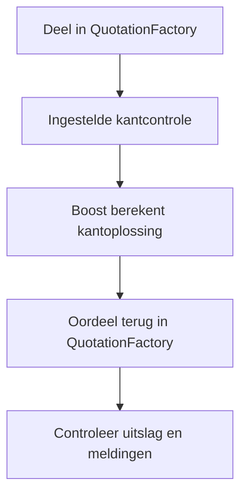
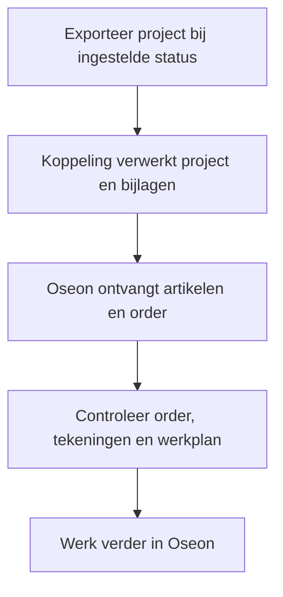

De calculatie begint in QuotationFactory. Controleer de overgenomen gegevens in Oseon voordat het werk naar productie gaat. De actieve routes en exportstatus hangen af van de inrichting.

[English](/qf2oseon/workflow) · [Overzicht](/nl/qf2oseon/overview)

## Kies de route

Een klant kan een aanvraag starten in het portaal van QuotationFactory. Een medewerker kan ook een aanvraag die per e-mail binnenkomt als project invoeren. In beide gevallen vindt de calculatie en beoordeling plaats in QuotationFactory. Een zichtbaar project in het portaal betekent op zichzelf niet dat de klant een order heeft geplaatst of geaccepteerd.

| Situatie | Wat gebeurt er? |
| --- | --- |
| Controle voor de offerte | De ingestelde Boost-controle geeft het oordeel terug aan QuotationFactory. Dit staat los van de orderexport naar Oseon. |
| Artikelen voorbereiden zonder klantorder | Als artikelverwerking en export bij **Quoted** zijn ingericht, kunnen geschikte artikelen zonder klantorder naar Oseon. In een inrichting met alleen artikelverwerking gebeurt dit ook bij exports met Ordered of Producing. Controleer de artikelen voordat je ze opnieuw gebruikt. |
| Klantorder | Na export van een project met status **Ordered** verwerkt de koppeling geschikte artikelen en maakt zij, indien ingeschakeld, een klantorder klaar voor import in Oseon. |
| Productieorder | Een export bij **Producing** kan ook productieorders klaarzetten als die route is ingeschakeld. |

De exportmomenten van de QF Edge Connector en de actieve routes hangen af van de inrichting. Een status in QuotationFactory bewijst op zichzelf niet dat een export of import in Oseon is geslaagd.

## Losse delen en samenstellingen

De klantorderimport maakt een positie voor elk deel in de geëxporteerde stuklijst, met het totale aantal voor het project. Dit is een delenlijst: ga er niet van uit dat geneste samenstellingen of subsamenstellingen als structuur in Oseon worden opgebouwd. Vergelijk posities en aantallen met het project in QuotationFactory. De keuze van het werkplan hangt af van de bewerkingen en de inrichting.

De artikelinterface verwerkt geschikte plaatdelen met een snijbewerking. Buizen volgen een aparte route als die is ingericht. Inkoop- en materiaalartikelen kunnen op de order voorkomen, maar een orderpositie betekent niet vanzelf dat ook een artikel in Oseon is aangemaakt. Controleer de beschikbaarheid van artikelen en materiaal in Oseon.

## Projectherkenning en voortgang

De klantorderimport gebruikt de project-ID van QuotationFactory als externe identificatie en geeft de projectreferentie apart mee. Het Oseon-ordernummer is een referentie van Oseon; beide helpen bij het terugzoeken.

Als statusfeedback is ingericht, kunnen ondersteunde orderstatussen uit Oseon het project in QuotationFactory bijwerken. Incomplete en Valid zijn statussen vóór productie en wijzigen de QF-status niet. Latere stappen kunnen zichtbaar zijn in het portaal, maar die zichtbaarheid bewijst niet welke wijzigingen in een specifieke inrichting automatisch verlopen.

## Controleer een kantdeel

Boost berekent een kantoplossing met de ingestelde machine en gereedschappen. QuotationFactory ontvangt het oordeel en de meldingen. Als een instelrapport beschikbaar is, kan dat meekomen. Een deel kan maakbaar, maakbaar met waarschuwing of niet maakbaar zijn. De controle informeert en blokkeert niet. Een gebruiker kan in QuotationFactory handmatig afwijken van het oordeel. Dat is een menselijke keuze, geen nieuwe Boost-berekening.

## Draag een order over en controleer die

1. Rond het project in QuotationFactory af en zet het op de afgesproken exportstatus.
2. Open de order en artikelen in Oseon. Vergelijk aantallen, materiaal, tekeningen en werkplan met het project.
3. Vul ontbrekende gegevens aan voordat de werkvoorbereiding verdergaat. Order en werkplan moeten aansluiten op het project.

Controleer de bestaande order in Oseon voordat een gewijzigd project opnieuw wordt geëxporteerd. Stel vast welke wijzigingen nodig zijn. Oseon bepaalt hoe de import een herhaalde order behandelt; een nieuwe export werkt de order niet noodzakelijk bij en voorkomt niet vanzelf dubbele orders.

Oseon verwerkt de orderimport zelf. Een bestand bij de importinterface bewijst nog niet dat de order compleet of productiegereed is. Als statusfeedback is ingericht, kan Oseon voortgang teruggeven aan QuotationFactory.

## Als een resultaat ontbreekt

Controleer de projectstatus en of de betreffende Edge Connector verbonden is. Ontbreekt een artikel, controleer materiaal en projectgegevens. Kijk bij een ontbrekende bewerking naar de vertaaltabel en de Oseon-bewerking. Ontbreekt een kantresultaat, controleer het STEP-bestand en of de controle aanstaat. Met het project- of ordernummer kan support de verwerking terugzoeken.
