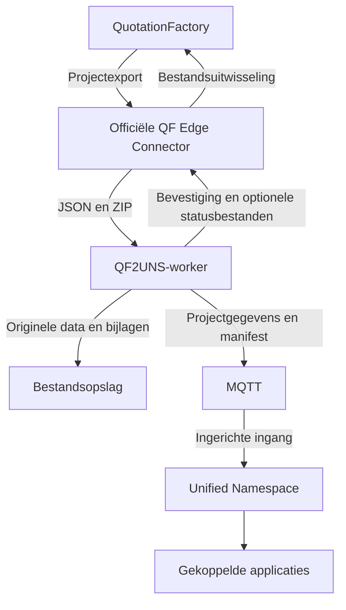

QF2UNS maakt een project uit QuotationFactory beschikbaar voor gekoppelde systemen via een Unified Namespace (UNS). De calculatie blijft in QuotationFactory staan. Een ontvangende applicatie kan de geëxporteerde projectgegevens gebruiken zonder ze opnieuw over te typen.

## Hoe loopt de koppeling?

De officiële QuotationFactory Edge Connector wisselt bestanden uit met QF2UNS. De worker leest de projectexport, bewaart de oorspronkelijke gegevens en bijlagen en publiceert projectgegevens via MQTT. Een apart ingerichte UMH-ingang brengt die berichten naar de UNS. Applicaties en databaseprojecties zijn afzonderlijke afnemers.

Voor deze route zijn QuotationFactory met de Edge Connector, QF2UNS, MQTT, opslag en een ingerichte UMH-ingang nodig. Een ontvangende applicatie of databaseprojectie komt daar als aparte component bij. Terugmelding van status is optioneel.

## Wat merkt de gebruiker?

De calculator blijft in QuotationFactory calculeren en exporteren. QF2UNS draagt de export over, maar vervangt het offertescherm niet en bepaalt niet wat een andere applicatie met het project doet. Die applicatie bepaalt waar de gegevens zichtbaar zijn en welke handelingen daar mogelijk zijn.

De worker geeft via de Edge Connector een bevestiging af na publicatie, of na een ingestelde bevestiging van een afnemer. Die overdracht bewijst niet dat QuotationFactory het bestand heeft verwerkt of dat een ontvangende applicatie een bedrijfsproces heeft afgerond. Status terugmelden is optioneel en afhankelijk van de gekoppelde bron.

[Volg een export](/nl/qf2uns/workflow) · [Zoek een ontbrekend project](/nl/qf2uns/troubleshooting) · [English](/qf2uns/overview) · [QF2UNS op de website](https://sheetmetalconnect.com/integratie-qf2uns)
