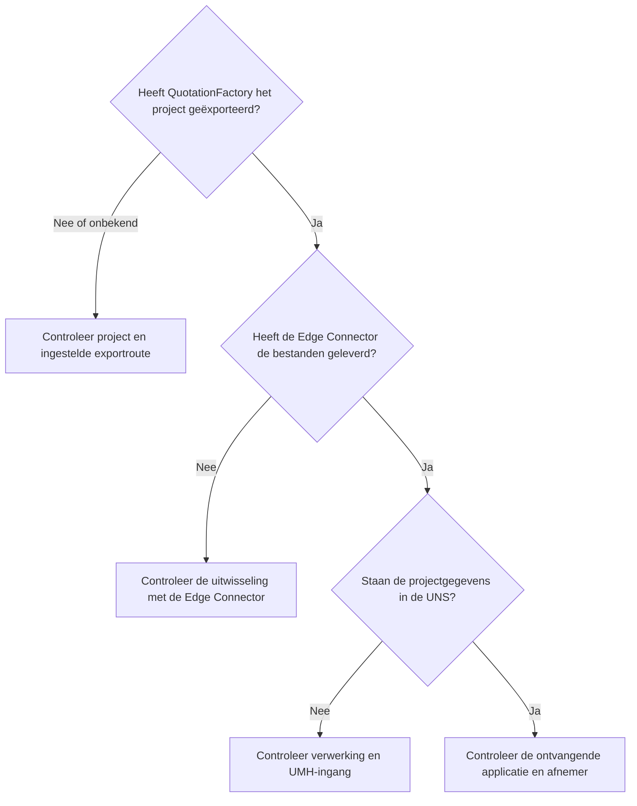

Ontbreekt een project na een QF2UNS-export? Bepaal dan tot waar het zichtbaar is. De Edge Connector, de worker, de UNS en de ontvangende applicatie hebben ieder een eigen rol.

## Het project staat niet in de ontvangende applicatie

Controleer eerst de projectreferentie en de export in QuotationFactory. De beheerder van de koppeling kan de export daarna volgen via de Edge Connector, QF2UNS en de UMH-ingang. Staan de gegevens in de UNS, controleer dan de verwerking en toegang in de ontvangende applicatie. Een draaiende worker of een ontvangstbevestiging van de broker bewijst niet dat de applicatie het project heeft ontvangen.

## Een bijlage of onderdeel ontbreekt

Vergelijk de ontvangende applicatie met het geëxporteerde project. De worker bewaart de oorspronkelijke gegevens en bijlagen vóór publicatie. De ontvangende applicatie moet die gegevens ook ondersteunen en tonen. Is de export onvolledig of ontbreekt het onderdeel nog steeds, geef de beheerder dan de projectreferentie en een omschrijving van wat ontbreekt.

## Een bijgewerkt project verschijnt niet

Controleer of een nieuwe export is gemaakt en welke revisie de ontvangende applicatie toont. Een gewijzigde export onder een opnieuw gebruikte bestandsnaam wordt geweigerd. De beheerder kan de uitwisseling en de oorzaak van het conflict onderzoeken zonder het oorspronkelijke bewijs te overschrijven.

## Wat betekent de bevestiging?

QF2UNS schrijft standaard na publicatie een bevestigingsbestand. Een installatie kan in plaats daarvan wachten op een ingestelde bevestiging van een afnemer. De Edge Connector moet het bestand vervolgens nog ophalen. Daarmee staat niet vast dat de QF-cloud het heeft verwerkt of dat een bedrijfsactie is afgerond. Optionele statusterugmelding volgt een eigen ingestelde route.

[Overzicht](/nl/qf2uns/overview) · [Export volgen](/nl/qf2uns/workflow) · [English](/qf2uns/troubleshooting)
