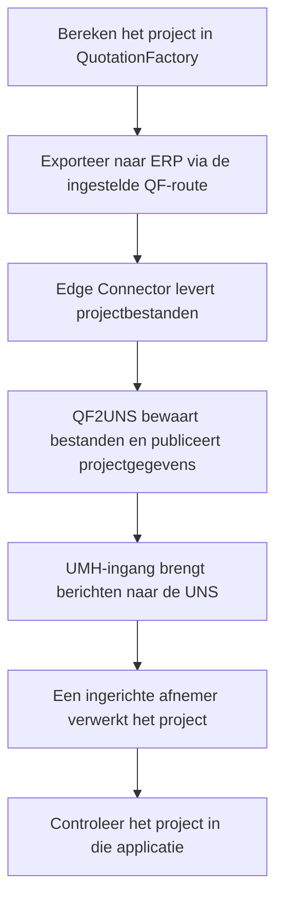
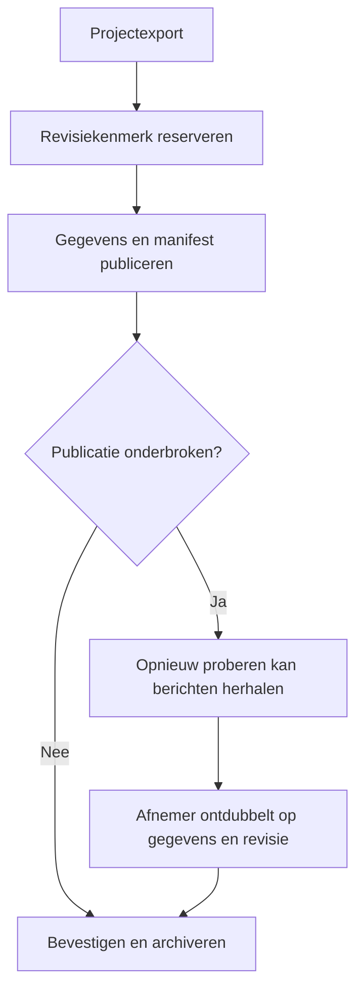

Een QF2UNS-export begint in QuotationFactory. Daarna komen projectgegevens beschikbaar voor de afnemers die op de UNS zijn aangesloten. De ontvangende applicatie bepaalt wat de gebruiker ermee kan doen.

## Van calculatie naar gekoppelde applicatie

1. **Exporteer het project.** Gebruik de gewone ERP-export in QuotationFactory of de exportinstellingen die voor de installatie zijn afgesproken. De Edge Connector levert de projectbestanden.
2. **Zoek het project in de ontvangende applicatie.** Controleer de projectreferentie en vergelijk de onderdelen en bijlagen die voor het werk nodig zijn. De weergave kan anders zijn dan in QuotationFactory.
3. **Werk verder in die applicatie.** Het eigen proces van die applicatie bepaalt de volgende handeling. QF2UNS keurt zelf geen offerte goed, maakt geen productieorder en registreert geen levering.
4. **Ontbreekt het project of een deel ervan?** Volg de [controles voor een ontbrekend project](/nl/qf2uns/troubleshooting). Een bevestiging van de koppeling bewijst op zichzelf niet dat de ontvangende applicatie het project heeft verwerkt.

## Als een project opnieuw wordt geëxporteerd

Een nieuwe export wordt als revisie verwerkt. De worker bewaart een revisiekenmerk en publiceert een manifest met de verwachte gegevens. Een ontvangend systeem kan die kenmerken en het manifest gebruiken om revisies te onderscheiden en de projectgegevens te controleren.

Bij een storing kunnen berichten opnieuw worden aangeboden. Afnemers moeten die ontdubbelen; de bevestiging garandeert geen eenmalige aflevering. Gebruikt een export dezelfde bestandsnaam met andere inhoud, dan weigert de worker het gewijzigde bestand.

[Overzicht](/nl/qf2uns/overview) · [Problemen oplossen](/nl/qf2uns/troubleshooting) · [English](/qf2uns/workflow)
