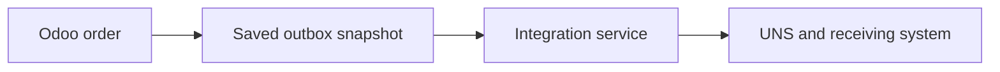
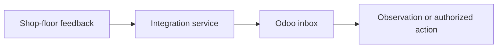

The Odoo UNS Connector gives a production system a consistent view of an Odoo order and gives Odoo a controlled way to receive feedback. This page explains the agreement behind the messages and why each handoff has a separate result.

[Nederlands](/nl/odoo-uns/architecture)

## Why a shared agreement matters

An order can pass through several systems, each using its own names and identifiers. Without an agreed meaning for those fields, a quantity can be linked to the wrong operation or interpreted in the wrong unit. A **data contract** specifies what an exchange represents, which fields and identifiers it uses, and how the participants interpret them.

For example, Odoo creates a production order for six panels. Each message carries a snapshot for a particular business identity, so a consuming system can refer to the same order or operation without depending on Odoo's internal tables.

| Agreement | Example and purpose |
| --- | --- |
| Order identity and planned quantity | The order snapshot identifies the order and describes six panels, the product, unit and state. |
| Operation identity and order reference | A separate operation snapshot identifies the work and links it to the order. |
| Execution owner | One configured system is allowed to report on that operation, so competing systems do not both obtain authority for the same operation. |
| Feedback quantity | A reported quantity is an observation. The sender must use units consistently: operation feedback has no unit field or conversion. |

The connector's manufacturing contract names are `_work_order` and `_operation`. Odoo owns the order and operation identities and their source snapshots. The installation's integration service maps these to the agreed hub contract and routes them to the intended systems. A hub may use a versioned contract of its own; that mapping must be explicit. The base snapshot names are unversioned, so changing an agreement requires coordinated mapping between the participants.

The add-on provides the Odoo records and interface. A separately configured integration service collects and delivers messages. The UNS and receiving application have their own responsibilities; the add-on does not itself run that delivery service.

## Why save an outbox instead of only calling a webhook?

A direct notification can fail after an order change has been saved. Reading the order again later may return a newer state instead of the state that caused the notification. The transactional outbox saves the snapshot in the same Odoo transaction as the tracked change. If that transaction rolls back, the snapshot rolls back too. Odoo can save the change without waiting for the receiving system. After an interruption, the separately configured service can resume collecting pending snapshots; each retains the content saved with its change.

A webhook can still be useful as a notification or to wake a worker. It is not by itself a durable record of the exact change. The external service needs its own durable custody and retry process. Neither the outbox nor a retry mechanism promises exactly-once delivery.

<Steps>
  <Step title="Odoo saves the change and snapshot">
    Creating an order or operation, or changing a tracked field, records a snapshot in **Outbox**. A draft order can produce one too. This is information, not a command to release work or start a machine.
  </Step>
  <Step title="The integration service collects it">
    The service fetches pending messages and acknowledges them when it reports that it has taken durable custody. **Acknowledged by hub** records that assertion. It does not prove that a broker, hub or final application processed the order.
  </Step>
  <Step title="The receiving system uses the agreed data">
    The integration maps and routes the snapshot. The receiving application decides how to use it according to the configured process. Delivery and production are separate results.
  </Step>
  <Step title="Odoo checks incoming feedback">
    The integration submits feedback to **Inbox**. Odoo validates its identity, order, operation, owner and requested effect. A valid observation can update the work order's feedback fields; a native time, completion or stock action has additional conditions and permissions.
  </Step>
</Steps>

## What a result proves

| Result | Meaning |
| --- | --- |
| **Pending** | The outgoing snapshot has no custody receipt yet. |
| **Acknowledged by hub** | A caller reported durable custody; this is not proof of downstream processing. |
| **Applied** | The feedback handler recorded its supported effect. That effect may be an observation only. |
| **Rejected** | The request was refused; inspect its reason. Some malformed requests fail before an inbox record can be created. |
| Duplicate response | The same feedback was submitted before. Its original result may be applied or rejected. |

A repeated feedback identity with different content is refused. An identical retry returns the original result rather than repeating the action. See [daily workflow](/odoo-uns/workflow) for the screens and [settings](/odoo-uns/settings) for the separate permissions.
