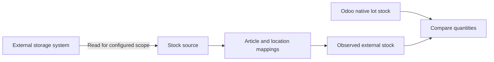
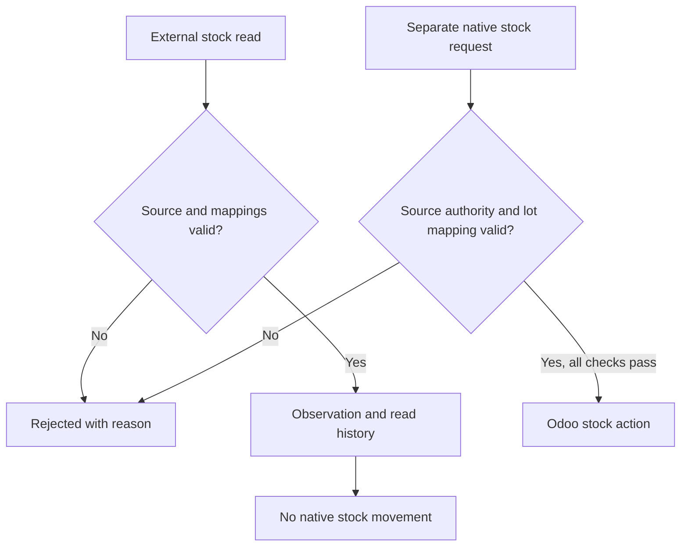

The optional Odoo UNS Connector stock extension shows what an external system reports for a defined scope. It helps a warehouse user compare an observation with Odoo's own stock without silently changing inventory or valuation.

[Nederlands](/nl/odoo-uns/external-stock)

## One scope, specific locations

Suppose an external storage system reports sheets in two locations: a rack and a cutting area. A configured source and scope identify the external query. Article mappings connect each external article, location and unit to an existing Odoo product, an existing **internal location** and the product's stock unit. The location on a mapping is specific: it does not select an entire warehouse or automatically include other locations.

For one product, the mappings can distinguish two positions:

| External location | Odoo internal location |
| --- | --- |
| `RACK-A` | `WH/Stock/Rack A` |
| `CUTTING` | `WH/Stock/Cutting` |

The integration service is configured to query the intended external scope and send the matching location references. A UNS Manager creates the corresponding Odoo mappings. The scope identifies that query; it is not an Odoo warehouse selector. Odoo distinguishes warehouses from their locations in its [inventory documentation](https://www.odoo.com/documentation/19.0/applications/inventory_and_mrp/inventory/warehouses_storage/inventory_management.html).

## Read the external position

<Steps>
  <Step title="Open the source">
    Open **UNS → External stock** and select the relevant source. Its company and scope identify which external read the page describes.
  </Step>
  <Step title="Inspect the observation">
    Under **Observed external stock**, check the mapped product, location and observed quantity. **Read history** shows previous reads. The latest successful read time tells when the connector last received a successful result; an external source timestamp can be absent.
  </Step>
  <Step title="Compare with Odoo stock">
    Compare the external position with **Native lot stock** where lot mappings are configured. Native stock and reservations are Odoo records. A difference needs investigation under the agreed process; the observation itself does not book a correction.
  </Step>
</Steps>

An empty read does not mean zero stock. A successful read of a partial scope does not establish quantities outside that scope. Freshness depends on the configured limit: a stale indication means the last successful read is older than that limit. It does not itself say what the physical quantity is now.

<Tabs>
  <Tab title="External observation">
    The source reports what it read for the configured scope. An observation does not change Odoo inventory.
  </Tab>
  <Tab title="Odoo stock">
    Native lot stock shows Odoo quantities and reservations for mapped lots. A separately authorized request may book a native movement after its checks pass.
  </Tab>
</Tabs>

## Configure the mapping

<Info>Source configuration and mappings are for a UNS Manager or administrator. A UNS User can read the information; the integration role submits the messages.</Info>

<Steps>
  <Step title="Define the external source and scope">
    In **UNS → External stock**, create a source with its company, source reference and scope reference. Together they identify the configured query scope for that company. The integration service must use the matching source and scope.
  </Step>
  <Step title="Map each external position">
    Under **Article mappings**, map the external article, location and unit to an existing product, internal Odoo location and its stock unit. The connector does not convert units. An unmapped article, location or unit causes the read to be rejected rather than guessed.
  </Step>
  <Step title="Add lot mappings when native booking is needed">
    **Native lot mappings** link an external lot to an existing lot of the mapped, lot-tracked product. Native stock booking is a separate authority on the source; observation does not enable it. An article mapping cannot be reassigned after it has an observed position or a lot mapping. The mapping lists do not offer deletion.
  </Step>
</Steps>

<Note>Enabling **Authorize native stock booking** authorizes the source for its supported native stock contracts together. It is not a per-location switch. Separate mapping and business checks still apply.</Note>

See [settings](/odoo-uns/settings) for production consumption and receipt publication, and [troubleshooting](/odoo-uns/troubleshooting) when a stock read or booking is rejected.
