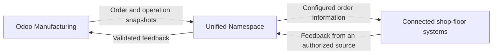

The Odoo UNS Connector connects Odoo Manufacturing with the shared production data layer. It sends order information outward and receives feedback from authorized systems, so your team can follow work across Odoo and the shop floor.

[Nederlands](/nl/odoo-uns/overview)

## What travels in each direction?

| Direction | Information | Effect |
| --- | --- | --- |
| Odoo to connected systems | Manufacturing orders and operations | Makes the order state available to the configured receiving systems. |
| Connected systems to Odoo | Operation progress and quantities | Records feedback from the configured execution owner. |
| Connected systems to Odoo, when enabled | Measured time and completion | Can create Odoo time entries or complete the authorized operation or order. |
| External stock to Odoo, when enabled | Lot stock observations and authorized bookings | Separates observed stock from changes actually booked in Odoo. |

A **snapshot** is a record of an order at a particular point. Even a draft order can produce a snapshot. Publishing it is not a command to release work or start a machine.

## Controlled feedback

One configured system owns feedback for each operation. Time recording, operation completion, manufacturing completion and stock booking need their own settings. Receiving a message does not enable all these actions.

The connector supports **Odoo 19**. What your users see depends on the installed components and agreed configuration.

Read the [workflow](/odoo-uns/workflow), [settings](/odoo-uns/settings) or [troubleshooting guide](/odoo-uns/troubleshooting). For commercial information, visit the [Odoo UNS Connector product page](https://sheetmetalconnect.com/integratie-odoo-uns-connector?lang=en).
