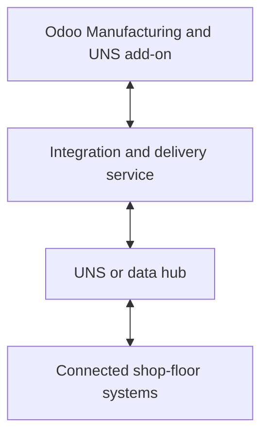

The Odoo UNS Connector shares manufacturing information with connected shop-floor systems and brings authorized feedback back to Odoo. Your team can follow the work without treating every observation as an automatic production booking.

[Nederlands](/nl/odoo-uns/overview)

## What the connector consists of

The connector separates message handling from manufacturing and stock so each installation can use the functions it needs.

| Component | Responsibility |
| --- | --- |
| UNS core (`smc_uns`) | Keeps the outgoing and incoming journals, custody receipts and feedback audit. It provides the shared UNS screens and access roles. |
| Manufacturing extension (`smc_mrp_uns`) | Adds order and operation snapshots, feedback fields and separately authorized production actions. It requires the UNS core and Odoo Manufacturing. |
| External stock extension (`smc_stock_uns`) | Optional. Adds external stock sources, observations, mappings and separately authorized native stock actions. |
| Manufacturing-stock extension (`smc_mrp_stock_uns`) | Optional. Connects authorized actual-lot material consumption to manufacturing component moves. |
| Integration service and UNS | A separately configured service collects and delivers messages through the shared data layer. It is not run by the Odoo add-ons. |

## How the pieces connect

A Unified Namespace (UNS) is a shared data layer for connected systems. The Odoo add-on works with a configured external integration and delivery service; the add-on itself is not the transport.

New manufacturing orders and tracked changes produce snapshots: records of the order at a point in time. Odoo saves each snapshot in an outbox alongside the change. If the connection is interrupted, the delivery service can retry recorded changes when it resumes. A draft snapshot is information, not a command to release work or start a machine.

**Pending** means the snapshot has no custody receipt yet; a service may already have fetched it. **Acknowledged by hub** means the integration service has reported durable custody; it does not mean every destination has processed it. Repeated feedback preserves the original accepted or rejected result, rather than repeating the action.

## What changes in Odoo?

The manufacturing order gains an **UNS Integration** tab with a read-only work-order reference. Managers and integration users can also have separate controls there. A work order gains its own **UNS Integration** tab, with identity and latest feedback. Your usual Odoo manufacturing, time and stock records remain where you check the business result.

Feedback can record an observation. Depending on separate permissions, it can also create time entries, complete an operation or manufacturing order, or book stock. Odoo is the default execution owner and rejects external operation feedback until a source is authorized.

Optional stock extensions keep external stock observations separate from native Odoo bookings. Additional capabilities can support authorized stock corrections, consumption using actual lots, and publication of received lots for products configured to participate. Manufacturing-order completion from feedback is limited to the full planned quantity. The [settings guide](/odoo-uns/settings) explains the boundaries.

Continue with the [daily workflow](/odoo-uns/workflow) or [troubleshooting](/odoo-uns/troubleshooting). See the [product page](https://sheetmetalconnect.com/integratie-odoo-uns-connector?lang=en) for commercial information.

<Columns cols={2}>
  <Card icon="diagram-project" title="How the exchange works" href="/odoo-uns/architecture">See why snapshots, custody and feedback have separate outcomes.</Card>
  <Card icon="boxes-stacked" title="External stock" href="/odoo-uns/external-stock">Compare an external read with Odoo stock by location.</Card>
</Columns>
