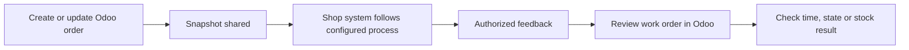
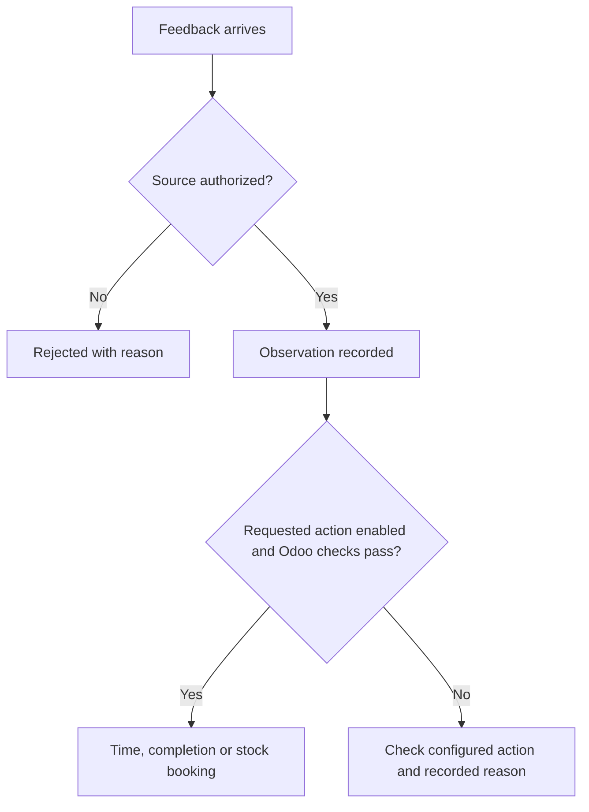

The Odoo UNS Connector adds information to the manufacturing and work orders your team already uses. Start there to follow an order and its feedback.

[Nederlands](/nl/odoo-uns/workflow)

<Steps>
  <Step title="Open the manufacturing order">
    In Odoo Manufacturing, open the order. Its **UNS Integration** tab shows the read-only **UNS Work-order Reference**. Creating an order or changing tracked order or operation information produces a snapshot.
  </Step>
  <Step title="Follow the work in the receiving system">
    The configured shop-floor system receives order information through the integration route. A snapshot of a draft is not a release command. Follow your agreed process to decide when work starts.
  </Step>
  <Step title="Open the work order">
    Open the relevant work order and its **UNS Integration** tab. **Identity** shows the operation reference, execution owner and work-center slug. **Latest Feedback** shows the latest type and time, external state, reported quantity, note and observed duration.
  </Step>
  <Step title="Check what changed in Odoo">
    Look at normal Odoo time tracking, work-order and manufacturing-order states, or component stock movements, as appropriate. The feedback fields show what was reported; the normal Odoo records show whether a booking or completion occurred.
  </Step>
</Steps>

## How feedback becomes an Odoo result

Observation alone does not complete production or change stock. Automatic completion supports the full planned quantity, not partial or scrap completion. Missing lot information, backorders, Odoo warnings or conflicting timers can prevent it.

For an unexpected result, see [troubleshooting](/odoo-uns/troubleshooting). An administrator can use the Outbox, Inbox and Feedback Audit when the normal records do not explain the issue.
