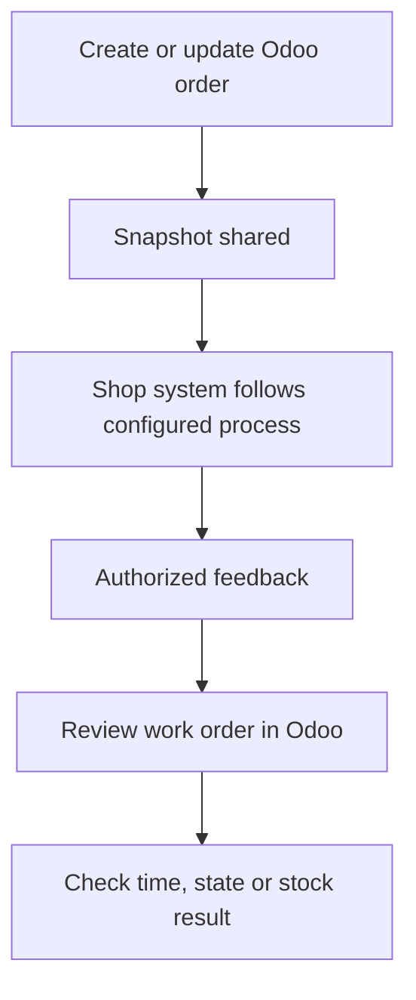
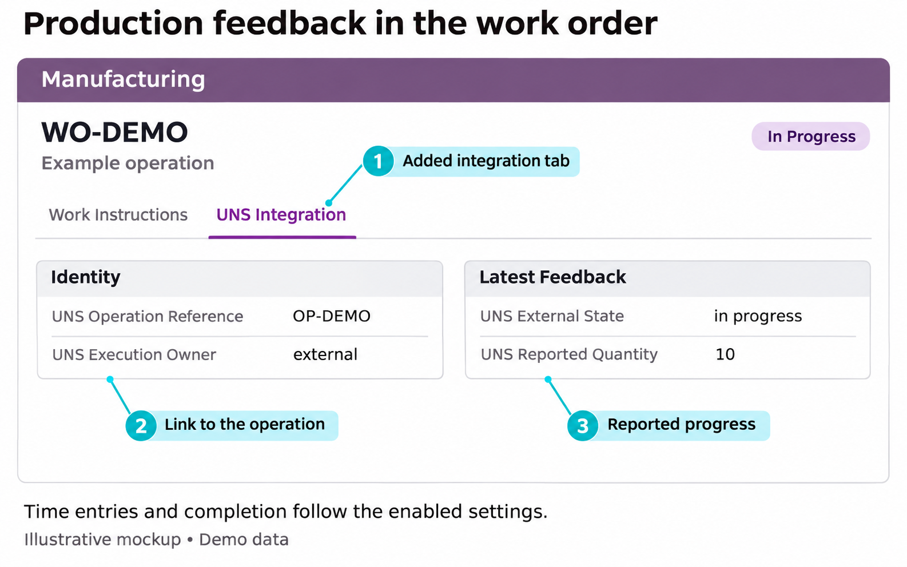
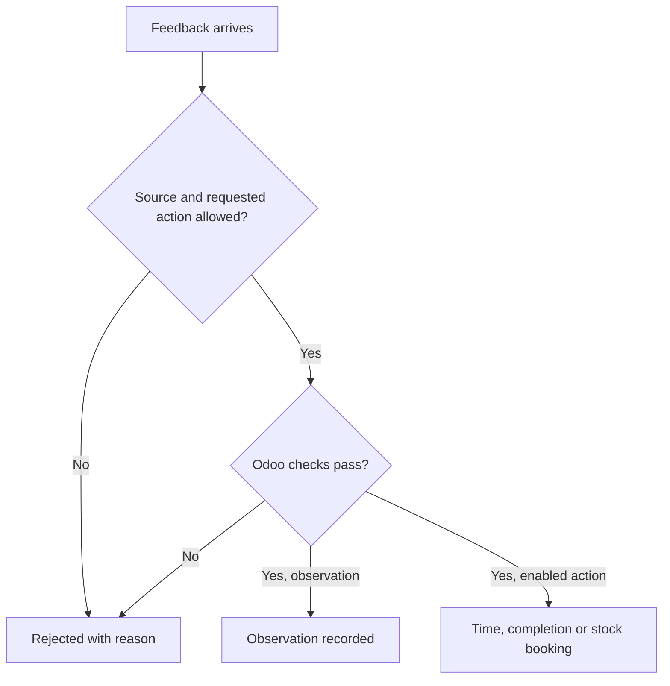
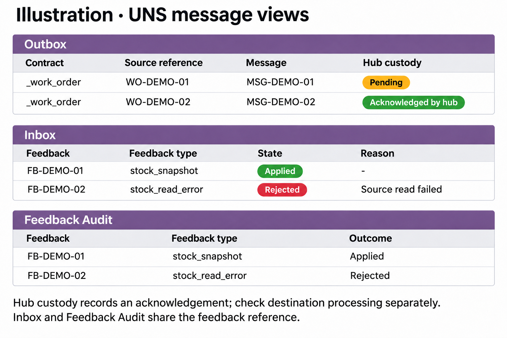

The Odoo UNS Connector adds information to the manufacturing and work orders your team already uses. Start there to follow an order and its feedback.

[Nederlands](/nl/odoo-uns/workflow)

<Steps>
  <Step title="Open the manufacturing order">
    In Odoo Manufacturing, open the order. Its **UNS Integration** tab shows the read-only **UNS Work-order Reference**. Creating an order or changing tracked order or operation information produces a snapshot.
  </Step>
  <Step title="Follow the work in the receiving system">
    The configured shop-floor system receives order information through the integration route. A snapshot of a draft is not a release command. Follow your agreed process to decide when work starts.
  </Step>
  <Step title="Open the work order">
    Open the relevant work order and its **UNS Integration** tab. **Identity** shows the operation reference, execution owner and work-center slug. **Latest Feedback** shows the latest type and time, external state, reported quantity, note and observed duration.
  </Step>
  <Step title="Check what changed in Odoo">
    Look at normal Odoo time tracking, work-order and manufacturing-order states, or component stock movements, as appropriate. The feedback fields show what was reported; the normal Odoo records show whether a booking or completion occurred.
  </Step>
</Steps>

<Frame caption="Illustrative mockup of a work order's UNS Integration tab. Layout and available fields vary by installation.">
  
</Frame>

## How feedback becomes an Odoo result

Observation alone does not complete production or change stock. Automatic completion supports the full planned quantity, not partial or scrap completion. Missing lot information, backorders, Odoo warnings or conflicting timers can prevent it.

For an unexpected result, see [troubleshooting](/odoo-uns/troubleshooting). A UNS User can inspect the message journals when the normal records do not explain the issue.

## Follow messages in Odoo

The **UNS** app separates the outgoing snapshot, incoming request and feedback result. These screens help locate the handoff; the ordinary Odoo records remain the place to check production and stock.

<Steps>
  <Step title="Find the outgoing snapshot">
    Open **UNS → Outbox** and find the order or message reference. **Pending** means it has not been acknowledged for custody. **Acknowledged by hub** means a caller reports that it has taken durable custody, not that the destination has processed it.
  </Step>
  <Step title="Find the incoming request">
    Open **UNS → Inbox** and find the feedback reference. **Received**, **Applied** and **Rejected** describe the Odoo request. A malformed request can fail before an inbox row exists.
  </Step>
  <Step title="Read the feedback result">
    Open **UNS → Feedback Audit** for the recorded feedback and outcome where an audit exists. Compare it with the work order's **Latest Feedback** and the normal time, order or stock records. A rejected request can have no feedback audit if processing failed before one was committed.
  </Step>
  <Step title="Compare external stock when relevant">
    Open **UNS → External stock** for the source's observations and read history. See [external stock](/odoo-uns/external-stock) for location mappings and the distinction from native stock.
  </Step>
</Steps>

<Frame caption="Illustration with demo data: separate outgoing and incoming messages, with the feedback audit below.">
  
</Frame>

A UNS User can read these screens. Creating mappings, changing permissions and manually enqueueing snapshots require additional authority. See [architecture](/odoo-uns/architecture) for the meaning of each handoff.
