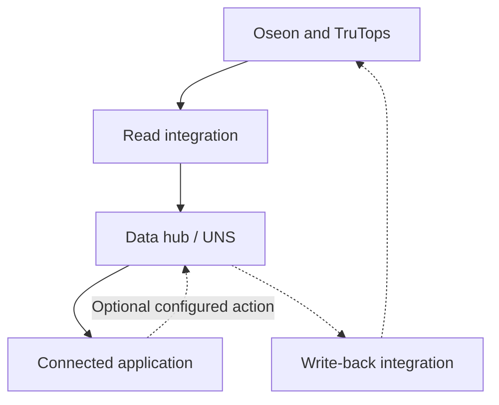

Oseon2UNS makes production information from TRUMPF Oseon and TruTops available on a data hub. Connected applications can use that information without each building a separate connection to Oseon.

[Nederlands](/nl/oseon2uns/overview)

## How the pieces connect

The integration reads supported TRUMPF interfaces and selected read-only database sources, then publishes available information to the unified namespace (UNS). A connected application consumes the relevant data. A separately configured optional route sends selected actions back to Oseon.

Depending on sources and configuration, data can include orders, operations, parts, machine information and stock. Oseon remains the source for records read from it. An application needs its own interface and logic to present or use them.

## Optional return route

Where enabled and supported by the installation, an application can send selected production feedback, such as operation start, quantity or completion. Other actions can be configured per installation. The application sends a request through the hub; the integration uses the Oseon interface and returns a result. Receipt is not proof that Oseon applied the change.

A read-only setup needs no write-back component. Available data and actions depend on the TRUMPF interfaces, application and agreed configuration. The integration does not supply a standard operator dashboard.

[Follow the workflow](/oseon2uns/workflow) · [Oseon2UNS on the website](https://sheetmetalconnect.com/integratie-oseon2uns?lang=en)
