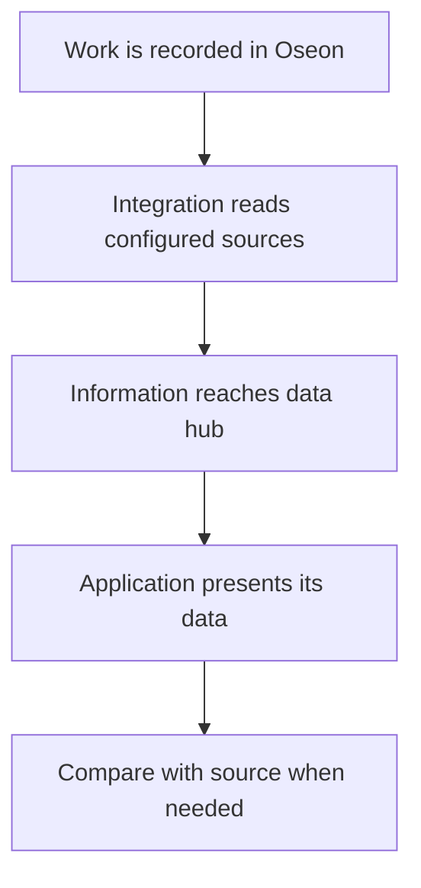
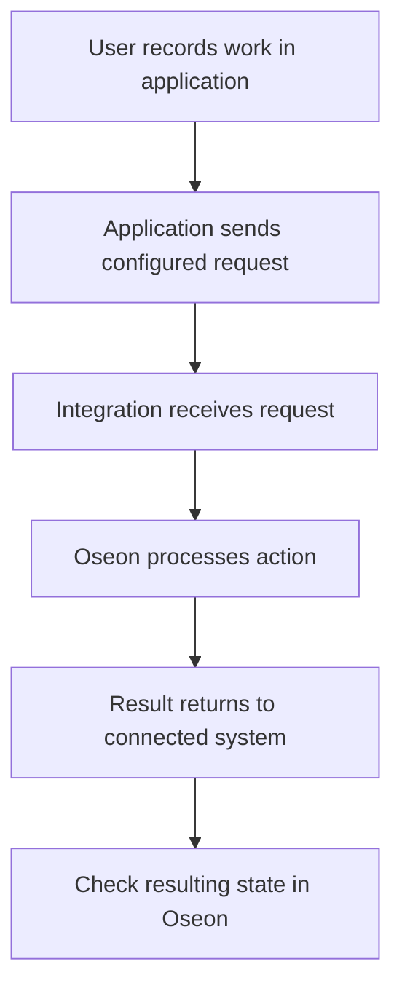

Oseon2UNS brings configured source information to the data hub. What a person sees and can do depends on the connected application and its permissions.

[Nederlands](/nl/oseon2uns/workflow) · [Overview](/oseon2uns/overview)

## Follow production information

Open the connected application and find the relevant order or operation using its reference. Available fields and update timing depend on the application. Compare an unexpected value with Oseon and the source record.

## Report work back when enabled

If the application and return route are configured for the action, record work with the application's normal controls. Depending on the setup this can include starting an operation, reporting a quantity or finishing an operation. Controls and permissions belong to the application.

A receipt means the request reached the integration. It does not mean the action succeeded in Oseon. Check the processing result and Oseon state. If the result is uncertain, establish the actual state before submitting the action again.

## If information is missing

Check that the order or operation exists in Oseon and the application shows the expected record. The setup determines which source data is available. If a feedback result is missing or unclear, give support the order and operation reference and check Oseon before repeating the action. An application may show only part of the source information.
