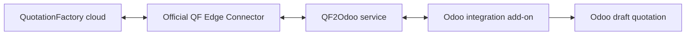

QF2Odoo carries a QuotationFactory project into Odoo as a draft quotation. Products, multilevel bills of materials, operations and attachments come with it, so your team can review the work without rebuilding its structure by hand.

[Nederlands](/nl/qf2odoo/overview)

## Start with your task

<CardGroup cols={2}>
  <Card title="Make a quotation" icon="file-lines" href="/qf2odoo/workflow#a-customer-uses-the-portal">Follow a portal, email or internal request into Odoo.</Card>
  <Card title="Prepare an assembly" icon="gears" href="/qf2odoo/workflow#prepare-a-part-or-assembly-before-an-order">Find the imported products, bills of materials and operations.</Card>
  <Card title="Process an order" icon="clipboard-check" href="/qf2odoo/workflow#from-quotation-to-payment">Review and confirm the draft, then follow production and delivery.</Card>
  <Card title="Revise a quotation" icon="clock-rotate-left" href="/qf2odoo/workflow#revisions-and-feedback">Understand a changed export and an identical replay.</Card>
</CardGroup>

See [imported data](/qf2odoo/imported-data) for field destinations and prerequisites.

## How the pieces connect

The official QuotationFactory Edge Connector links the cloud to the QF2Odoo service. That service imports the project through the required Odoo integration add-on. An optional Odoo workspace adds views and reports.

The service builds on QuotationFactory's official Edge exchange: QuotationFactory supplies its export and receives the result through that route, while the Odoo add-on handles the Odoo side. Keeping those responsibilities separate allows the optional workspace and exchanges to be added where needed. This direct integration does not require a Unified Namespace (UNS).

After confirmation, Odoo's own procurement rules determine how work proceeds. Manufactured products created by the connector use manufacture and replenishment on order; existing purchased products keep their Odoo routes. The setup can also use an explicit subcontracting flow where configured.

## What happens next?

QuotationFactory holds the quotation project and calculation. Odoo holds customer, supplier and catalogue master data, and owns order confirmation, production, delivery and accounting.

A successful import returns its result and Odoo reference to QuotationFactory. Marking a project **Ordered** in QuotationFactory does not confirm the Odoo quotation or create manufacturing demand. Your team reviews and confirms it in Odoo.

Optional exchanges let QuotationFactory request selected master-data snapshots and receive configured production and delivery statuses. Invoicing, payment and reconciliation remain standard Odoo processes.

## What changes in Odoo?

The core add-on adds QF information to the quotation, manufacturing order and work order when relevant. The optional workspace adds **Sales → Orders → QF Projects**, source and production links, and a **QuotationFactory** tab. The quotation itself remains the normal Odoo form.

<Note>
  These guides describe Odoo 19. Screens and exchanges depend on your installed release and configuration.
</Note>

Follow the [daily workflow](/qf2odoo/workflow), explore [settings](/qf2odoo/settings), or find a [missing result](/qf2odoo/troubleshooting). See also [QF2Odoo on the website](https://sheetmetalconnect.com/integratie-qf2odoo?lang=en).
