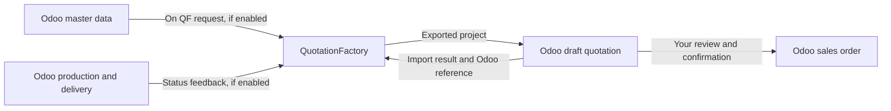

QF2Odoo brings an exported QuotationFactory project into Odoo as a **draft quotation** with products, bills of materials, operations and attachments. Your team reviews the result in Odoo before confirming an order.

[Nederlands](/nl/qf2odoo/overview)

## What each system owns

| Information or decision | Where it belongs |
| --- | --- |
| Quotation project, calculation and source files | QuotationFactory |
| Customer, supplier and catalogue article master data | Odoo |
| Imported quotation review and sales-order confirmation | Odoo |
| Manufacturing, delivery, invoicing and payment handling | Odoo |

The imported manufacturing information can include multilevel bills of materials, operations and drawings. The quotation remains a draft until normal Odoo confirmation. A QuotationFactory project marked **Ordered** does not confirm it or create manufacturing demand.

A successful import returns its result and the Odoo quotation or order reference to QuotationFactory. This core reply is separate from optional production-status feedback.

## Optional return exchanges

When configured, QuotationFactory can request master-data snapshots from Odoo. Production and delivery statuses can also return to QuotationFactory. These are specific exchanges, not unrestricted synchronization of both systems.

The connector does not automate invoice creation, payment collection or payment reconciliation.

## Continue

Read the [daily workflow](/qf2odoo/workflow), check [settings and optional features](/qf2odoo/settings), or find help with a [missing result](/qf2odoo/troubleshooting).

For product fit and commercial information, visit [QF2Odoo on the website](https://sheetmetalconnect.com/integratie-qf2odoo?lang=en).
