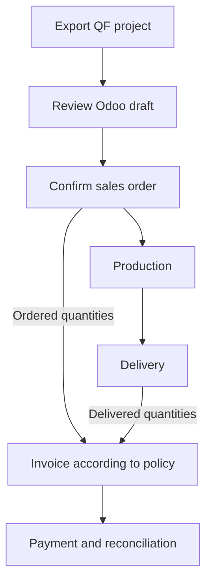
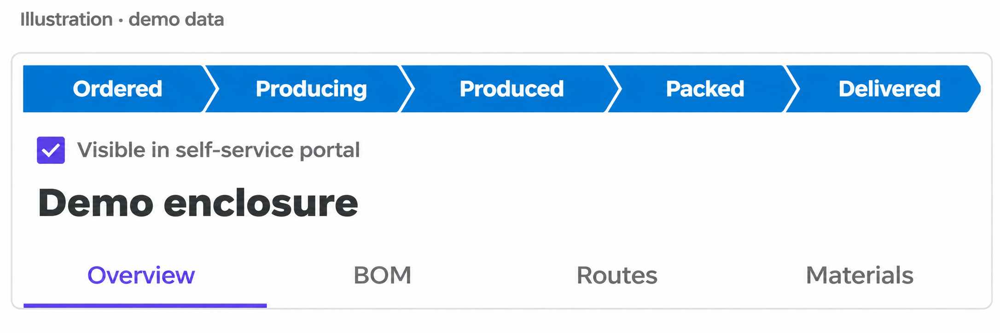
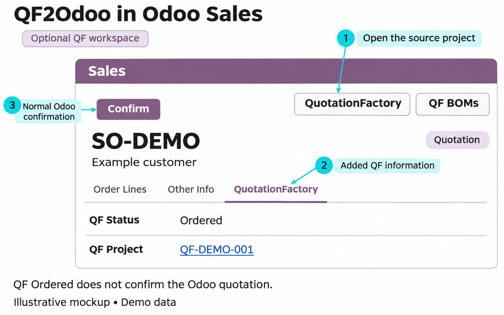
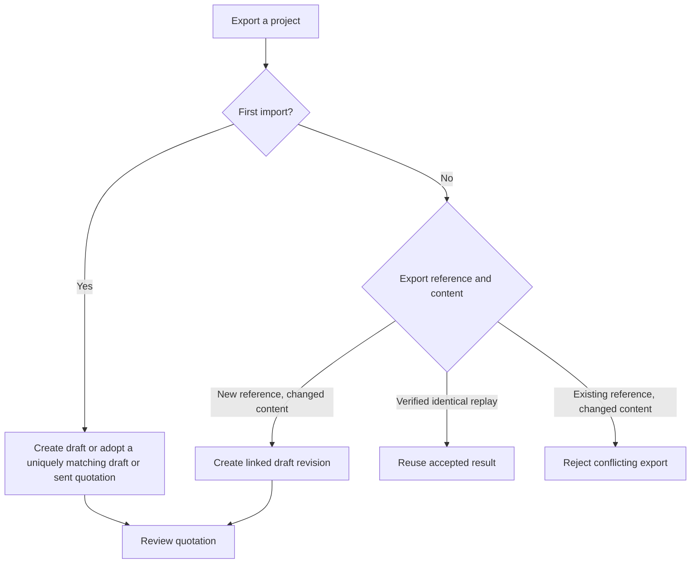

QF2Odoo creates a draft in Odoo from your exported QuotationFactory project. Follow that draft through review, confirmation and the normal Odoo sales process.

[Nederlands](/nl/qf2odoo/workflow)

Start with the situation that matches the request:

<CardGroup cols={2}>
  <Card title="Customer portal request" icon="user" href="#a-customer-uses-the-portal">A customer starts the request in QF.</Card>
  <Card title="Email or internal request" icon="envelope" href="#a-request-arrives-by-email-or-is-started-internally">Staff create the QF project.</Card>
  <Card title="Prepare a part or assembly" icon="gears" href="#prepare-a-part-or-assembly-before-an-order">Inspect engineering before confirmation.</Card>
  <Card title="Revise a quotation" icon="clock-rotate-left" href="#revisions-and-feedback">See how a changed export is handled.</Card>
</CardGroup>

See [imported data](/qf2odoo/imported-data) for destinations, requirements and ownership.

## Choose how the request starts

A project can begin with a customer in the QuotationFactory portal or with an employee preparing the calculation. Both routes meet at the configured QF export. The connector imports that export into Odoo; it does not turn an incoming email into a QF project.

### A customer uses the portal

<Steps>
  <Step title="Customer: start the request">The customer prepares a request in the QF portal.</Step>
  <Step title="Staff: calculate and export">Review and calculate the project in QuotationFactory. Use the configured export process.</Step>
  <Step title="Staff: review the Odoo quotation">The import returns an Odoo reference to the QF project. Open the draft in Odoo and check its contents.</Step>
  <Step title="Staff: handle acceptance">Handle acceptance through the normal sales process before confirming the quotation in Odoo.</Step>
</Steps>

The QF project visibility checkbox controls whether the project is visible to the customer in QF. It is separate from the source flag identifying a project created in the portal. With the optional Odoo workspace and its default protection enabled, that origin flag protects commercial fields on draft or sent quotations against ordinary edits. Shipping and work preparation remain editable. Neither visibility nor the protection flag proves customer acceptance.

### A request arrives by email or is started internally

<Steps>
  <Step title="Staff: create and calculate">Use the request and drawings to create and calculate a project in QuotationFactory.</Step>
  <Step title="Staff: export">Use the configured QF export process. The connector does not read email or create a project from it.</Step>
  <Step title="Staff: review in Odoo">Open the resulting draft using the returned reference. Review it and handle acceptance before confirming it.</Step>
</Steps>

A project made by staff is not automatically a portal-origin project merely because it is made visible to the customer.

### Prepare a part or assembly before an order

A project can contain an individual manufactured part or an assembly with several levels. On import, QF2Odoo creates revision-specific Odoo products, bills of materials and operations alongside the draft quotation. Staff can inspect those engineering records before confirming the order. Import alone creates no manufacturing or stock demand.

The documented export is a project-to-quotation import. A separate product-only or bill-of-materials-only import, independent of a quotation, is not described as a supported mode. Normal Odoo procurement and manufacturing rules apply after confirmation.

<Frame caption="Illustrative QF header with demo data; English labels are localized.">
  
</Frame>

The configured feedback covers Producing, Produced and Delivered, not Packed.

### Follow the project in both systems

QuotationFactory owns its project, calculation, customer-facing visibility and project stages. Odoo owns the customer and catalogue records, order confirmation, manufacturing and delivery. QF decides which project stages trigger export; QF2Odoo does not filter imports by stage. A successful import returns an Odoo reference to QF.

When enabled, Odoo sends the configured production and delivery statuses back to QF. QF stages such as packaging can be managed in QF; the integration does not automatically report a packaging stage. The portal shows the QF project according to its visibility setting, not a live Odoo screen. Verify quantities and acceptance in the relevant system.

## From quotation to payment

<Steps>
  <Step title="Export the project">
    Complete the project in QuotationFactory and use your configured export process. A successful import returns an Odoo reference to QuotationFactory. Keep the project reference for your search.
  </Step>
  <Step title="Find the draft in Odoo">
    Open the quotation using the returned reference. If the optional workspace is installed, open **Sales → Orders → QF Projects**. The default **Current QF Projects** filter can hide older or incomplete imports; remove it if needed. The result is a normal Odoo quotation linked to its source.
  </Step>
  <Step title="Review the imported work">
    Check customer, quantities, prices, terms and attachments against the source. With the optional workspace installed, open **QF BOMs** to inspect the linked Odoo bills of materials and operations. Without it, find the bills of materials through standard Odoo Manufacturing. The **QuotationFactory** tab shows source information when the workspace is installed. If something is missing, check the [troubleshooting guide](/qf2odoo/troubleshooting) before confirming.
  </Step>
  <Step title="Confirm the order">
    After customer acceptance and your normal commercial checks, according to your company process, click **Confirm** on the Odoo quotation. Its state changes to a sales order and Odoo follows its configured procurement and manufacturing rules. A QF **Ordered** status alone does not do this. An incomplete import blocks confirmation.
  </Step>
  <Step title="Follow production and delivery">
    Open the linked manufacturing orders and work orders in Odoo. Use **Production x/y** on a QF-linked order when the optional workspace is installed. Complete production through the normal Odoo process, then open the delivery, check quantities and validate it. A partial delivery records only the quantities delivered.
  </Step>
  <Step title="Create and confirm the invoice">
    On the sales order, use **Create Invoice**, choose the relevant option and **Create Draft**. Review the draft invoice and click **Confirm** to post it. Ordered-quantity invoicing can be available after order confirmation; delivered-quantity invoicing depends on validated deliveries and can include a partial delivery.
  </Step>
  <Step title="Record payment">
    On the confirmed invoice, use **Pay**, then **Create Payment**. Odoo normally shows **In payment** until bank reconciliation; configuration can mark it **Paid** immediately. QF2Odoo does not create invoices, collect payments or reconcile them.
  </Step>
</Steps>

<Frame caption="Illustrative mockup of a quotation with the optional QF workspace. Layout and available fields vary by installation.">
  
</Frame>

## What the integration adds

With the optional workspace, **QuotationFactory** opens the source project, **QF BOMs** opens the linked Odoo bills of materials, and **Production x/y** opens manufacturing orders. The native Manufacturing button is hidden only on QF-linked orders. The **QuotationFactory** tab shows source status, import and source dates, link and contacts. Once production exists, the workspace also shows **Production Progress**, **Now At** and **Hours Booked**.

Without that workspace, the core add-on can still show **QF Quotation**, **QF Source Information**, and **QF Production Instructions** tabs where relevant. Standard Odoo remains responsible for confirmation, manufacturing, delivery and accounting.

## Revisions and feedback

| Export situation | Result in Odoo |
| --- | --- |
| First import and one matching draft or sent quotation | The import can add QF data to that quotation. An ambiguous match blocks import. |
| Changed content with a new export reference | A linked draft revision is created, including after a sent quotation or confirmed order. |
| Verified identical replay | The earlier accepted result is reused; no new revision is created. |
| Changed content under an existing export reference | The conflicting export is refused. |

<Warning>A new draft does not change the earlier confirmed order or its production demand. Review the current draft and handle confirmation through the normal Odoo process.</Warning>

The commercial protection setting can make draft and sent portal-origin commercial fields read-only for ordinary users; revise those at the QF source or through authorized administration. Shipping and work preparation remain editable. Protection is not evidence of customer acceptance.

If status feedback is enabled, the default mappings report **Producing** when manufacturing is underway, **Produced** when all non-cancelled manufacturing orders are done, and **Delivered** after any validated outgoing delivery. Delivered can mean a partial delivery. Status can also move backward as Odoo changes.

See Odoo’s guides to [invoicing policies](https://www.odoo.com/documentation/19.0/applications/sales/sales/invoicing/invoicing_policy.html) and [payments](https://www.odoo.com/documentation/19.0/applications/finance/accounting/payments.html) for the standard financial process.
