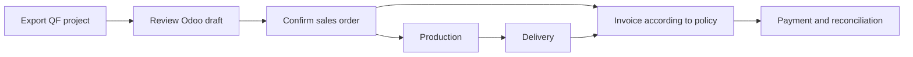
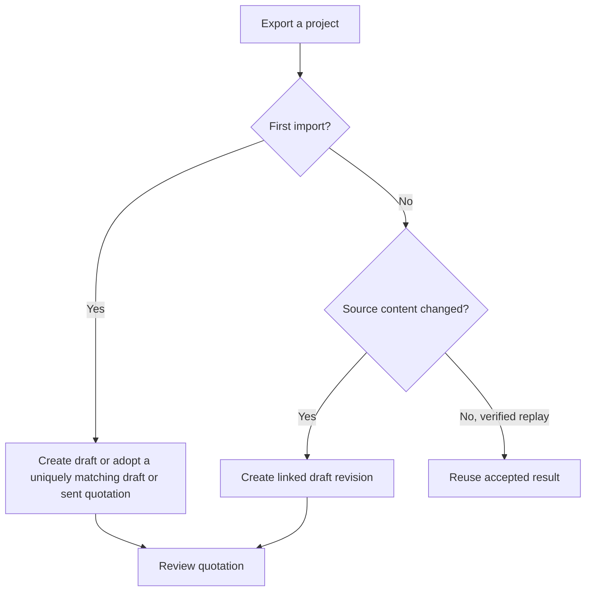

QF2Odoo creates a draft in Odoo from your exported QuotationFactory project. Follow that draft through review, confirmation and the normal Odoo sales process.

[Nederlands](/nl/qf2odoo/workflow)

## From quotation to payment

<Steps>
  <Step title="Export the project">
    Complete the project in QuotationFactory and use your configured export process. A successful import returns an Odoo reference to QuotationFactory. Keep the project reference for your search.
  </Step>
  <Step title="Find the draft in Odoo">
    Open the quotation using the returned reference. If the optional workspace is installed, open **Sales → Orders → QF Projects**. The default **Current QF Projects** filter can hide older or incomplete imports; remove it if needed. The result is a normal Odoo quotation linked to its source.
  </Step>
  <Step title="Review the imported work">
    Check customer, quantities, prices, terms and attachments against the source. With the optional workspace installed, open **QF BOMs** to inspect the linked Odoo bills of materials and operations. Without it, find the bills of materials through standard Odoo Manufacturing. The **QuotationFactory** tab shows source information when the workspace is installed. If something is missing, check the [troubleshooting guide](/qf2odoo/troubleshooting) before confirming.
  </Step>
  <Step title="Confirm the order">
    After customer acceptance and your normal commercial checks, according to your company process, click **Confirm** on the Odoo quotation. Its state changes to a sales order and Odoo follows its configured procurement and manufacturing rules. A QF **Ordered** status alone does not do this. An incomplete import blocks confirmation.
  </Step>
  <Step title="Follow production and delivery">
    Open the linked manufacturing orders and work orders in Odoo. Use **Production x/y** on a QF-linked order when the optional workspace is installed. Complete production through the normal Odoo process, then open the delivery, check quantities and validate it. A partial delivery records only the quantities delivered.
  </Step>
  <Step title="Create and confirm the invoice">
    On the sales order, use **Create Invoice**, choose the relevant option and **Create Draft**. Review the draft invoice and click **Confirm** to post it. Ordered-quantity invoicing can be available after order confirmation; delivered-quantity invoicing depends on validated deliveries and can include a partial delivery.
  </Step>
  <Step title="Record payment">
    On the confirmed invoice, use **Pay**, then **Create Payment**. Odoo normally shows **In payment** until bank reconciliation; configuration can mark it **Paid** immediately. QF2Odoo does not create invoices, collect payments or reconcile them.
  </Step>
</Steps>

<Frame caption="Illustrative mockup of a quotation with the optional QF workspace. Layout and available fields vary by installation.">
  
</Frame>

## What the integration adds

With the optional workspace, **QuotationFactory** opens the source project, **QF BOMs** opens the linked Odoo bills of materials, and **Production x/y** opens manufacturing orders. The native Manufacturing button is hidden only on QF-linked orders. The **QuotationFactory** tab shows source status, import and source dates, link and contacts. Once production exists, the workspace also shows **Production Progress**, **Now At** and **Hours Booked**.

Without that workspace, the core add-on can still show **QF Quotation**, **QF Source Information**, and **QF Production Instructions** tabs where relevant. Standard Odoo remains responsible for confirmation, manufacturing, delivery and accounting.

## Revisions and feedback

Confirmed orders are protected. An initial import can adopt a uniquely matching draft or sent quotation. The commercial protection setting can make draft and sent portal-origin commercial fields read-only for ordinary users; revise those at the QF source or through authorized administration. Shipping and work preparation remain editable. Protection is not evidence of customer acceptance.

If status feedback is enabled, the default mappings report **Producing** when manufacturing is underway, **Produced** when all non-cancelled manufacturing orders are done, and **Delivered** after any validated outgoing delivery. Delivered can mean a partial delivery. Status can also move backward as Odoo changes.
