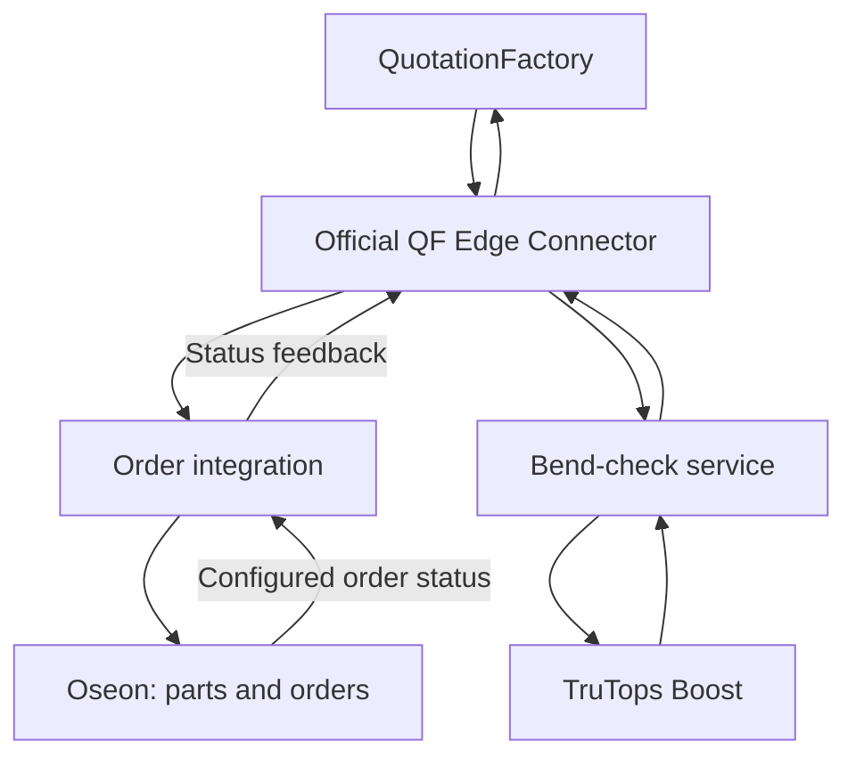

QF2Oseon connects QuotationFactory to TRUMPF Oseon and TruTops Boost. It carries project data into production preparation and returns bend feasibility results to the calculation, reducing repeated entry between systems.

[Nederlands](/nl/qf2oseon/overview)

## Find the task

<CardGroup cols={2}>
  <Card title="Check a bent part" icon="check" href="/qf2oseon/workflow#check-a-bent-part">Review the Boost verdict in QuotationFactory.</Card>
  <Card title="Prepare parts" icon="gears" href="/qf2oseon/workflow#choose-the-route">Send eligible parts to Oseon, with or without a customer order.</Card>
  <Card title="Transfer an order" icon="clipboard" href="/qf2oseon/workflow#transfer-and-review-an-order">Export the project and review the result in Oseon.</Card>
  <Card title="Check data and revisions" icon="list-check" href="/qf2oseon/workflow#what-reaches-oseon">See what is transferred and what to check after a change.</Card>
</CardGroup>

## How the pieces connect

QuotationFactory's official Edge Connector exchanges files with two integration services. The order service transfers project data to Oseon. The separate Boost service requests bend calculations and returns their results to QuotationFactory.

The order route uses the TRUMPF interface for parts and the Oseon import interface for customer orders. The bend route needs a configured TruTops Boost environment, including the relevant machines and tools. The routes can serve different purposes; their availability depends on the installation.

## What each system does

QuotationFactory holds the calculation and project. Oseon holds the imported production data and manages the work that follows. Boost calculates a bend solution against its configured machine and tooling. The integration moves and translates information between them; it does not replace review in either application.

The order route can create parts, working plans and customer orders from exported data. Drawings and other attachments follow the configured exchange. Mappings connect QuotationFactory operations to existing Oseon workplaces and worksteps. The details and enabled flows depend on the installation.

[Follow the workflow](/qf2oseon/workflow) · [QF2Oseon on the website](https://sheetmetalconnect.com/integratie-qf2oseon?lang=en)
