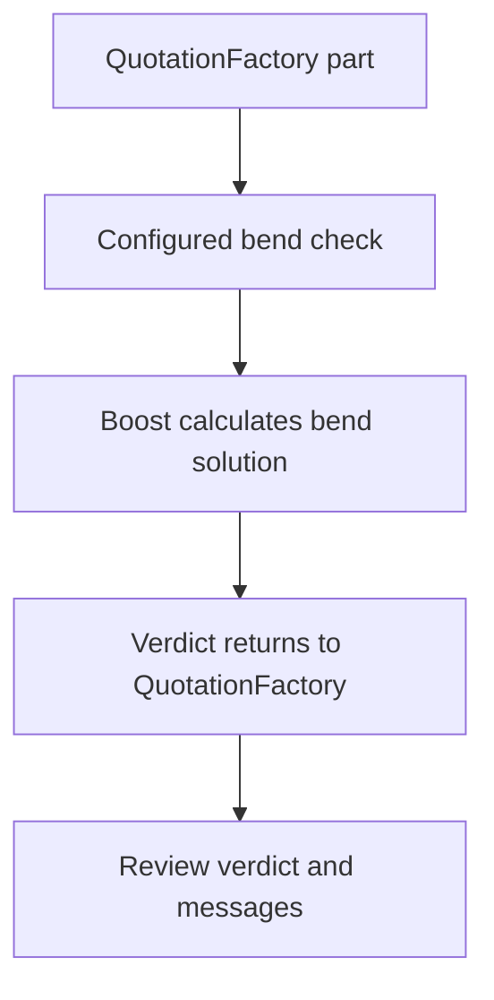
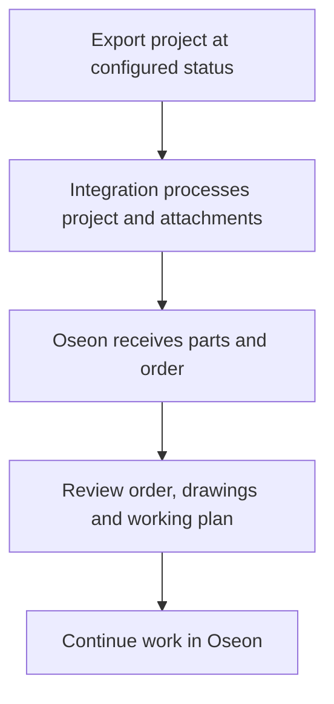

Use QuotationFactory for calculation and review the imported information in Oseon before production. The available flows and export trigger depend on the agreed setup.

[Nederlands](/nl/qf2oseon/workflow) · [Overview](/qf2oseon/overview)

## Check a bent part

Boost uses the configured machine and tools to calculate a bend solution. QuotationFactory receives the verdict and messages; a setup report can accompany the result when available. A part can be manufacturable, manufacturable with a warning, or not manufacturable. The verdict informs the calculation and does not block it. A user can override it in QuotationFactory; this is a human decision, not a new Boost calculation.

## Transfer and review an order

1. Complete the QuotationFactory project and move it through the configured export status.
2. Open the resulting order and parts in Oseon. Compare quantities, material, drawings and working plan with the project.
3. Resolve missing information before continuing work preparation. The order and working plan should match the project.

Before re-exporting a changed project, check the existing order in Oseon and establish which changes are needed. Oseon decides how its import handles a repeated order; do not assume a re-export updates it or avoids duplicates.

Oseon processes the order import itself. A file delivered to its import interface does not prove the order is complete or ready for production. Configured status feedback can return Oseon progress to QuotationFactory.

## If a result is missing

Check the project status and whether the relevant Edge Connector is connected. For a missing part, check material and project data. For a missing working-plan step, check the operation mapping and Oseon workstep. For a missing bend result, check that a STEP file exists and the check is enabled. Support can trace processing using the project or order reference.
