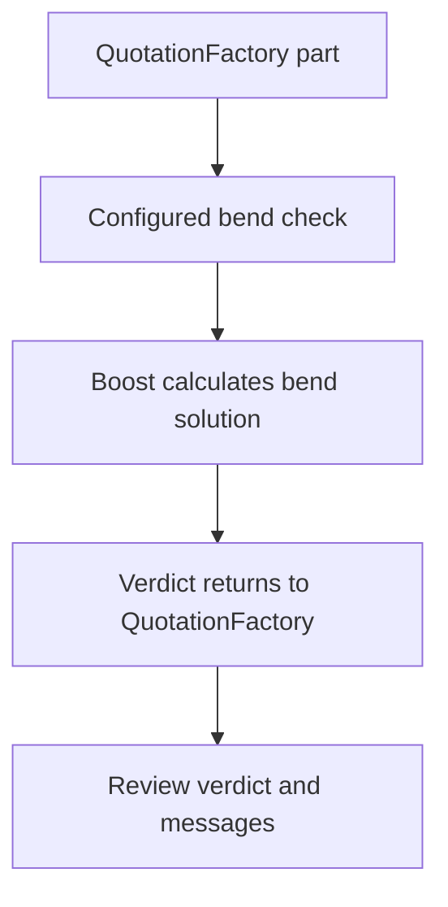
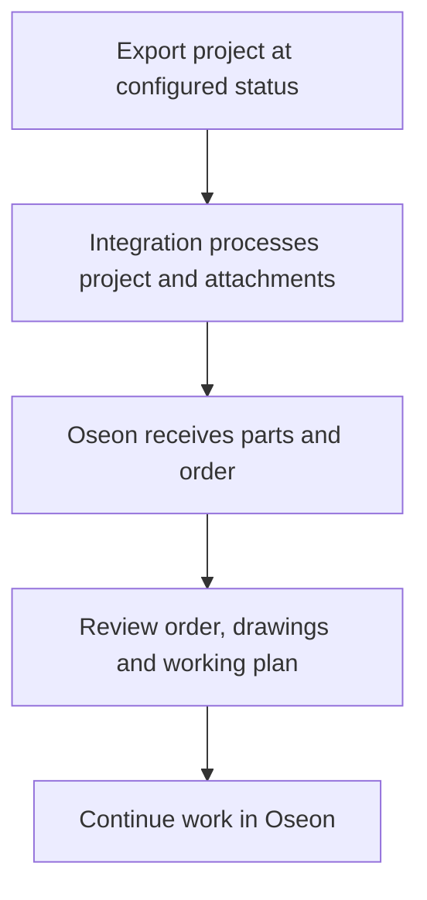

Use QuotationFactory for calculation and review the imported information in Oseon before production. The available flows and export trigger depend on the agreed setup.

[Nederlands](/nl/qf2oseon/workflow) · [Overview](/qf2oseon/overview)

## Choose the route

A customer can start a request in the QuotationFactory portal, or staff can enter a request received by email as a QuotationFactory project. In either case, the project is calculated and reviewed in QuotationFactory. Portal visibility does not by itself mean that the customer placed or accepted an order.

| Situation | What happens |
| --- | --- |
| Check before a quote | The configured Boost check returns its verdict to QuotationFactory. It is separate from the Oseon order export. |
| Prepare parts without a customer order | When part processing and an export at **Quoted** are configured, eligible parts can be sent to Oseon without a customer order. The parts-only configuration also processes eligible parts on Ordered or Producing exports. Review the resulting articles before reusing them. |
| Customer order | Once the project reaches **Ordered** and is exported, the integration processes eligible parts and, if enabled, prepares a customer order for Oseon to import. |
| Production order | An export at **Producing** can also prepare production orders when that route is enabled. |

The QF Edge Connector's export triggers and enabled routes are configured per installation. A status in QuotationFactory alone does not prove that an export or an Oseon import succeeded.

## Single parts and assemblies

The customer-order import creates a position for each part in the exported bill of materials, using its total project quantity. This is a part list; do not assume that nested assemblies or subassemblies are recreated as an Oseon assembly structure. Check the positions and quantities against the QuotationFactory project. The selected working-plan mapping depends on the part's activities and the installation's settings.

The parts interface processes eligible sheet-cutting parts; tube processing uses a separate configured route. Other purchased or material items may appear in order positions, but an order position does not guarantee creation of a corresponding Oseon article. Check article and material availability in Oseon.

## Project identity and progress

The customer-order import carries the QuotationFactory project ID as its external identity and the project reference separately. The Oseon order number is an Oseon reference; use both when tracing an order.

When status feedback is configured, supported Oseon order states can update the QuotationFactory project. Incomplete and Valid are pre-production states and do not change its QF status. Later portal stages are visible in QuotationFactory, but their visibility alone does not establish which changes are automatic in a particular installation.

## Check a bent part

Boost uses the configured machine and tools to calculate a bend solution. QuotationFactory receives the verdict and messages; a setup report can accompany the result when available. A part can be manufacturable, manufacturable with a warning, or not manufacturable. The verdict informs the calculation and does not block it. A user can override it in QuotationFactory; this is a human decision, not a new Boost calculation.

## Transfer and review an order

1. Complete the QuotationFactory project and move it through the configured export status.
2. Open the resulting order and parts in Oseon. Compare quantities, material, drawings and working plan with the project.
3. Resolve missing information before continuing work preparation. The order and working plan should match the project.

Before re-exporting a changed project, check the existing order in Oseon and establish which changes are needed. Oseon decides how its import handles a repeated order; do not assume a re-export updates it or avoids duplicates.

Oseon processes the order import itself. A file delivered to its import interface does not prove the order is complete or ready for production. Configured status feedback can return Oseon progress to QuotationFactory.

## If a result is missing

Check the project status and whether the relevant Edge Connector is connected. For a missing part, check material and project data. For a missing working-plan step, check the operation mapping and Oseon workstep. For a missing bend result, check that a STEP file exists and the check is enabled. Support can trace processing using the project or order reference.
