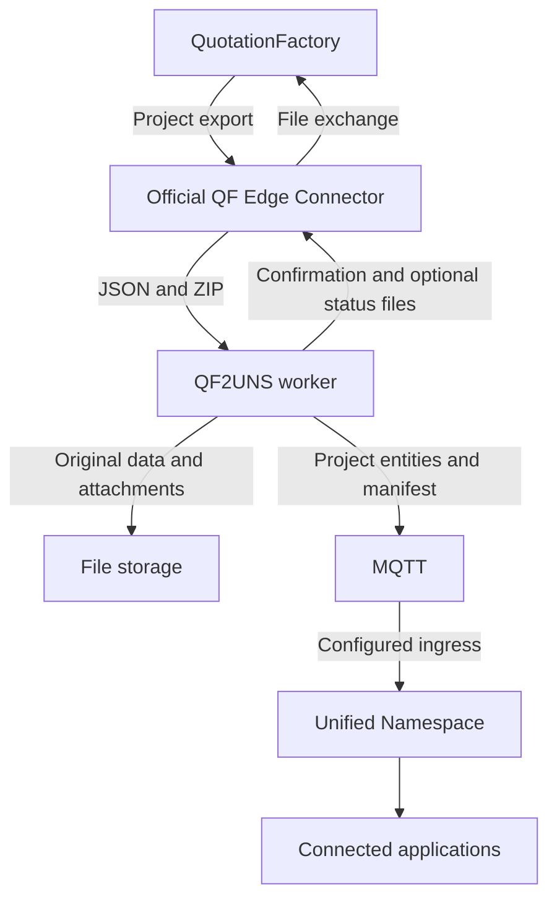

QF2UNS makes a QuotationFactory project available to connected systems through a Unified Namespace (UNS). The calculation remains in QuotationFactory; a receiving application can use the exported project data without someone retyping it.

## How the pieces fit

The official QuotationFactory Edge Connector exchanges files with QF2UNS. The worker reads the project export, preserves the original data and attachments, and publishes structured project entities to MQTT. A separately configured UMH ingress brings those messages into the UNS. Applications and database projections are separate consumers.

QuotationFactory and its Edge Connector, QF2UNS, MQTT, storage and a configured UMH ingress are needed for this route. A receiving application or database projection is an additional component, selected for the process. The status subscriber is optional.

## What changes for the team?

The estimator continues to calculate and export in QuotationFactory. QF2UNS transfers the exported data; it does not replace the quotation screen or decide what a downstream application does with the project. The receiving application determines where its users see the data and which actions are available there.

The worker sends a confirmation through the Edge Connector after publication, or after a configured downstream acknowledgement. A confirmation is a file handoff, not proof that QuotationFactory accepted it or that a consuming application completed a business process. Status feedback is optional and depends on the connected producer.

[Follow an export](/qf2uns/workflow) · [Find a missing project](/qf2uns/troubleshooting) · [Nederlands](/nl/qf2uns/overview) · [QF2UNS on the website](https://sheetmetalconnect.com/integratie-qf2uns?lang=en)
