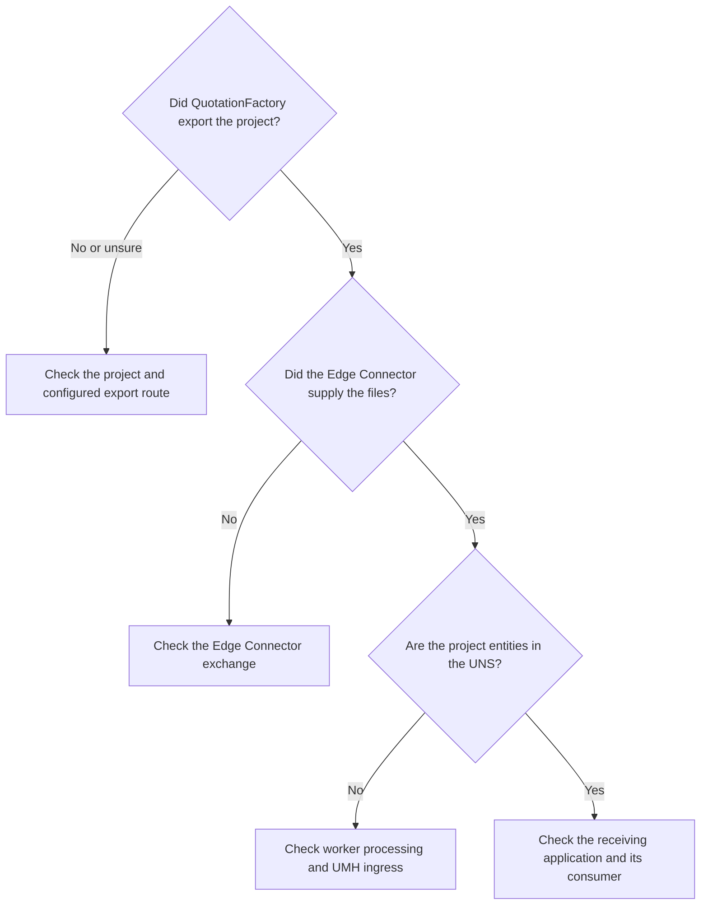

If a project is missing after a QF2UNS export, identify the last place where it is visible. The Edge Connector, worker, UNS and receiving application each have a separate role.

## The project is not in the receiving application

Check the project reference and export in QuotationFactory first. Then ask the integration operator to trace the export through the Edge Connector, QF2UNS and UMH ingress. If the entities are in the UNS, check the receiving application's own processing and access. A running worker or a broker receipt alone does not prove that the application received the project.

## An attachment or part is missing

Compare the receiving application with the exported project. The worker preserves original data and attachments before publishing; the receiving application must also support and display the relevant information. If the export is incomplete or the application still lacks an item, give the operator the project reference and the missing item's description.

## An updated project did not appear

Check that a new export was made and identify which revision the receiving application shows. A changed export under a reused filename is rejected. The integration operator can inspect the exchange and resolve the source of the conflict without overwriting the original evidence.

## What does confirmation mean?

QF2UNS writes a confirmation file after publication by default. An installation can instead wait for a configured downstream acknowledgement. Either way, the file still needs to be picked up by the Edge Connector; it does not prove QF cloud acceptance or a completed business action. Optional status feedback follows its own configured route.

[Overview](/qf2uns/overview) · [Export workflow](/qf2uns/workflow) · [Nederlands](/nl/qf2uns/troubleshooting)
