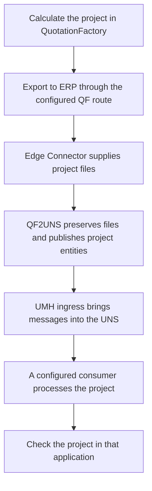
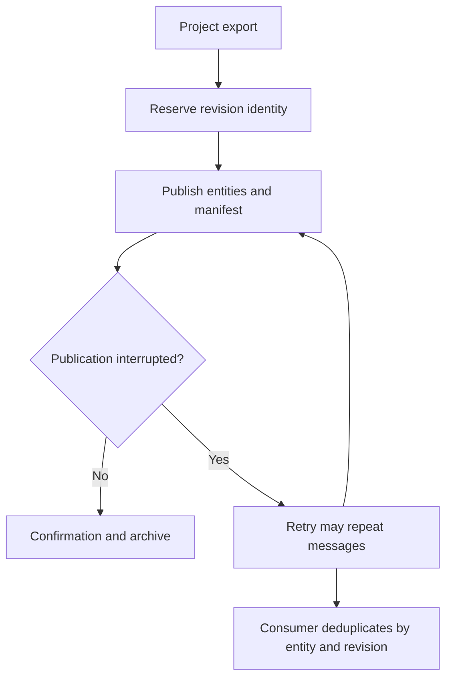

A QF2UNS export starts in QuotationFactory and ends with project data available to configured UNS consumers. The receiving application determines what its users can do next.

## From calculation to connected application

1. **Export the project.** Use QuotationFactory's normal export to ERP, or the export settings agreed for the installation. The Edge Connector supplies the project files.
2. **Look for the project in the receiving application.** Search using the project reference and compare the parts and attachments needed for the work. The application may show a different view from QuotationFactory.
3. **Continue in that application.** Its own workflow determines the next action. QF2UNS does not itself approve a quotation, create a production order, or record a delivery.
4. **If the project is missing or incomplete**, follow [the checks for a missing project](/qf2uns/troubleshooting). A connector confirmation alone does not establish that the receiving application processed it.

## When a project is exported again

A new export is handled as a revision. The worker keeps a revision identity and publishes a manifest describing the expected entities. A receiving system can use those identities and the manifest to distinguish revisions and reconcile the project.

A retry can repeat messages around a failure. Consumers must deduplicate them; the confirmation is not a guarantee of exactly-once delivery. If an export reuses a filename with different contents, the worker rejects it rather than treating the changed file as the earlier export.

[Overview](/qf2uns/overview) · [Troubleshooting](/qf2uns/troubleshooting) · [Nederlands](/nl/qf2uns/workflow)
